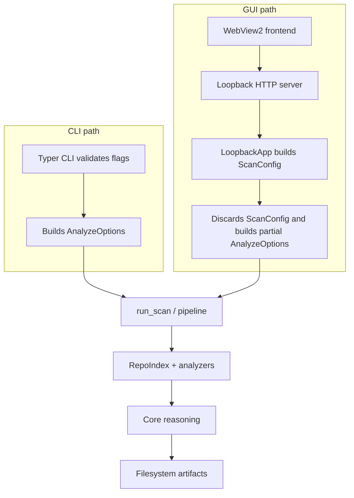
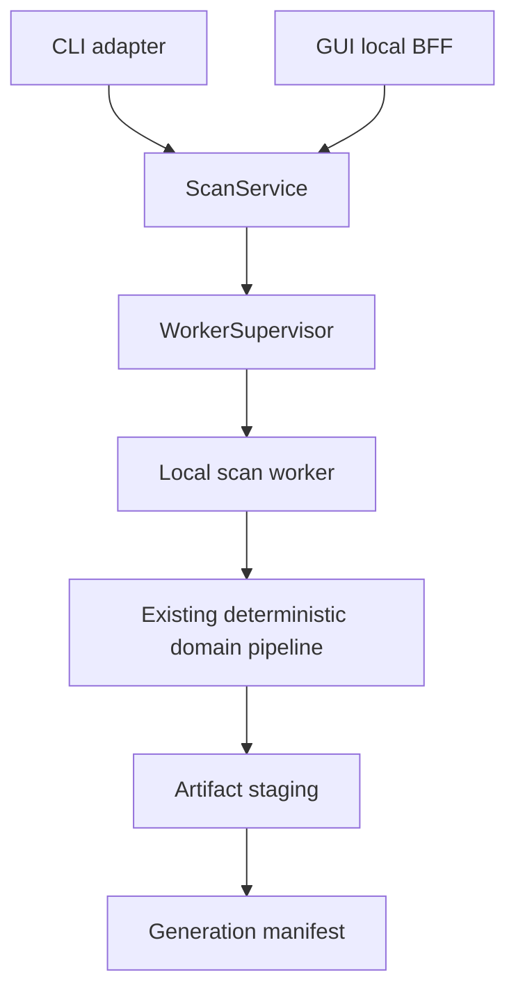

<!-- ATTACKMAP_DOC_STATUS: HISTORICAL_REFERENCE -->
> **STARÝ DOKUMENT — pro agenty nerelevantní jako aktuální plán nebo zadání (20. 10. 2026).**
> Práci řídí pouze dokumenty v [aktuálním rozcestníku](README.md). Tento text je historická reference: neobnovovat jeho TODO, priority ani statusy dokončení. Technické podklady a kritéria použít jen v rozsahu potřebném pro aktivní WP úkol a ověřit proti aktuálnímu kódu.

# AttackMap - Architectural review and P0/P1 remediation plan

- **Reviewed commit:** `0c7776c` (HEAD → main)
- **Date:** 13 October 2026
- **Scope:** Core engine, analyzer contract, Windows desktop GUI, packaging, CI
- **Output:** This document is the textual counterpart to the interactive canvas
  `C:/Users/maluc/.cursor/projects/c-Projects-IN-PROGRESS-AttackMap/canvases/attackmap-architecture-review.canvas.tsx`

---

## 1. Executive summary

### 1.1 What AttackMap is

AttackMap is a local-first defensive static-analysis product. It reads a repository,
models the attack surface, traces data flows and trust boundaries, and produces an
evidence-grounded, prioritized security review. It is exposed as:

- a Python Typer CLI (`attackmap analyze ...`),
- a new Windows desktop GUI built on pywebview + WebView2,
- a reusable GitHub Action,
- a public analyzer plugin SDK.

The product deliberately has no operational database, message broker, distributed cache,
tenant model, or always-on SaaS backend. Four small core dependencies support CLI execution,
typed modeling, graph traversal, and YAML parsing. Optional LLM narration is a downstream
consumer of deterministic evidence.

### 1.2 Principal conclusion

The **domain core is sound**: evidence-first, deterministic, well-tested, and already
separated from optional AI. The immediate risk is the **application layer around the
new Windows GUI**: orchestration is duplicated, cancellation is fake, several toolbar
controls are not forwarded, credentials leak into process-global state, and plugins run
with full in-process authority.

The recommended target architecture is therefore **not** a microservice split, CQRS, or
event sourcing. It is the same modular monolith behind a single, shared application API,
with scans executed in a **supervised local worker process**.

### 1.3 Keep, stop, and start

| Keep | Stop | Start |
|---|---|---|
| Evidence-first deterministic core | Adding GUI features directly into `LoopbackApp` | One shared `ScanService` for CLI and GUI |
| Safe filesystem layer and untrusted-repo guards | Mutating `os.environ` with LLM credentials | Run identity and explicit state machine |
| Analyzer/core responsibility split | Accepting "cancelled" without real cancellation | Supervised worker with hard cancellation |
| Deterministic merge and ordering | Reusing report directories without generations | Atomic artifact generations |
| Optional, redacted, cost-tracked LLM use | Loading arbitrary third-party plugins by default in packaged GUI | Official-only default in packaged GUI |

### 1.4 Architectural maturity (directional)

| Dimension | Score | Reason |
|---|---|---|
| Core domain and evidence model | 8/10 | Strong boundaries, redaction, taxonomy, fingerprints |
| Analyzer/plugin architecture | 6/10 | Good discovery/merge, weak isolation and broad contract |
| Application orchestration | 4/10 | CLI and GUI mappings have diverged |
| Desktop runtime reliability | 3/10 | Cancellation and overlapping-run semantics are unsafe |
| Security posture | 6/10 | Strong repo safety; GUI/plugin gaps are material |
| Performance headroom | 5/10 | Bounded algorithms, but memory and fleet execution are serial |
| Observability | 5/10 | Progress and manifests exist; run identity/error telemetry is incomplete |
| Test/release system | 4/10 | Large suite; Windows hermeticity and packaging CI are broken |
| Developer experience | 5/10 | Good SDK docs; tooling/version/docs drift remains |

---

## 2. Architecture

### 2.1 Layer-by-layer analysis

| Layer | Current implementation | Architectural implication |
|---|---|---|
| Product shape | Local CLI + Windows desktop; static defensive analysis | No SaaS database, tenant model, or durable queue |
| Frontend | Vanilla JS/CSS in pywebview/WebView2 | Global module state; 800 ms polling; full-report fetch |
| Local BFF | `ThreadingHTTPServer` on `127.0.0.1` with random token | Useful local adapter, but mutable shared state and weak run lifecycle |
| Application layer | Typer CLI and GUI both construct `AnalyzeOptions` | Duplicated mapping is the main architectural defect |
| Execution | In-process sequential analysis; daemon threads in GUI | No hard cancellation, timeout, crash, or plugin isolation |
| Indexing | `RepoIndex` performs a shared safe walk/read | All text retained; no aggregate byte cap; later passes may reread disk |
| Plugins | Python entry points, metadata, detection, deterministic order | `AnalyzerResult` aliases the large evolving `ScanResult` |
| Domain reasoning | Taint, SBOM, supply chain, workflows, authz, anomaly, graph/risk | Strong deterministic core; several large modules |
| Persistence | Filesystem artifacts and small JSON caches | No artifact-set transaction or generation manifest |
| Cache | OSV JSON TTL cache only | Appropriate; Redis/shared cache is not justified |
| LLM | Optional post-analysis review/hunt/remediation/triage | Good evidence-first placement; global env and total-cost gaps |
| Observability | NDJSON progress, analyzer errors, run-manifest timings | No unified run identity, structured GUI errors, traces, or complete cost |
| Deployment | Python package, GitHub Action, manual PyInstaller onedir | Windows release chain and reproducibility lag the core |

### 2.2 Current execution flow



The current flow is functional for the CLI, but the GUI path has diverged: `ScanConfig`
and the generated CLI argument vector are constructed and then thrown away.

```startLine:300:endLine:328:src/attackmap/ui/server.py
    cfg = ScanConfig(
        repos=app.repos,
        output=app.output,
        run_cve=app.cve,
        modules=[m for m in app.modules if m and m.lower() != "auto"],
        llm_mode=app.llm_mode,
        provider=app.provider,
        model=app.model,
        recall=app.recall,
        no_suppress=app.no_suppress,
        baseline=baseline if app.use_baseline else None,
        fail_on_new_high=app.fail_on_new_high,
        capabilities=app.capabilities if app._caps_loaded else None,
    )
    argv = [sys.executable, "-m", "attackmap", *cfg.cli_args()]
```

The actual in-process scan ignores the generated configuration:

```startLine:353:endLine:360:src/attackmap/ui/server.py
            options = AnalyzeOptions(
                repo_path=app.repos[0].resolve(),
                output=(app.output or (app.repos[0] / "reports")).resolve(),
                output_format="all",
                analyzers=None,
```

### 2.3 Recommended target execution flow



The `ScanService` owns run identity, validation, and terminal state. The
`WorkerSupervisor` spawns, streams NDJSON progress, cancels, and enforces resource
policy. The existing domain pipeline stays inside the worker, preserving its
sequential, deterministic semantics.

### 2.4 Recommended application contract

```python
RunSummary = ScanService.execute(
    request: ScanRequest,
    progress: ProgressSink,
    cancellation: CancellationToken,
)
```

`RunSummary` must contain:

- `run_id`
- `terminal_state` (`succeeded | failed | cancelled`)
- `artifact_manifest` with generation-scoped paths
- `stage_timings`, `errors` (typed), `analyzer_manifest`, `llm_usage`

Only the application layer may depend on Typer, pywebview, and subprocess
management. Domain modules must not.

### 2.5 Target folder shape (incremental)

```text
src/attackmap/
  application/
    scan_request.py       # validated single/fleet request
    scan_service.py       # shared orchestration facade
    run_state.py          # explicit state machine and typed errors
  execution/
    worker_protocol.py    # versioned NDJSON request/progress/result
    worker_supervisor.py  # spawn, cancel, timeout, resource policy
    worker_main.py        # frozen-compatible internal entry point
  analyzers.py            # retain current implementation initially
  pipeline.py             # decompose by stage, preserve behavior
  artifacts/
    manifest.py           # generation IDs and atomic promotion
    compatibility.py      # current attackmap-report.json export
  ui/
    server.py             # thin local BFF only
    ...existing frontend
```

Move mature scanner modules only after a stage has a stable interface and tests.
Do not reorganize the tree for appearance.

### 2.6 Pattern decisions

| Pattern | Decision | How to apply |
|---|---|---|
| Modular monolith | Adopt and strengthen | Explicit application/execution/artifact boundaries; one codebase and release |
| DDD | Use lightly | Treat analysis, policy, artifacts, plugin SDK, and shell as bounded contexts; avoid ceremony |
| CQRS | Do not adopt as infrastructure | Typed commands and read models inside the local BFF; no separate stores |
| Event sourcing | Reject | Persist immutable run manifests and progress logs only where diagnostic value justifies it |
| BFF | Formalize existing local BFF | Loopback server adapts GUI requests and report views; it does not own scan semantics |
| Database | Not now | Filesystem artifacts remain authoritative; add SQLite only for cross-run history/search demand |
| Remote services | Future option only | Only after measured multi-user fleet demand and explicit code-egress controls |
| AI-native | Continue evidence-first | Version evidence packs, measure model cost, verify citations; never let LLM output become source truth |

---

## 3. Risk register

### 3.1 Prioritized risks

| Priority | Risk | Impact | Evidence | Recommended control | Horizon |
|---|---|---|---|---|---|
| P0 | GUI silently ignores fleet and analyzer selections | A successful-looking review can omit requested repos or analyzers | `src/attackmap/ui/server.py:300-376` | Shared fleet orchestration used by CLI and GUI | Now |
| P0 | Cancel changes UI state but does not stop analysis | Work continues and can overlap or overwrite a later scan | `src/attackmap/ui/server.py:227-230,392-394`; `src/attackmap/ui/runner.py:131-138` | Supervised worker with real termination and run-generation guards | Now |
| P0 | Full pytest collection is broken | `python -m pytest` fails before running tests | `src/attackmap/__main__.py:1-5` | Guard `app()` with `if __name__ == "__main__"` | Now |
| P1 | LLM credentials and base URL leak into global state | A later cloud request can inherit a stale local/custom endpoint; plugins can read keys | `src/attackmap/ui/server.py:377-385` | Per-worker environment with guaranteed restore | Now |
| P1 | Report generations are not isolated | Old AI/diff/fleet sidecars can be shown as current evidence | `src/attackmap/ui/report.py:171-186`; `src/attackmap/ui/output.py:29-46` | Generation directories with atomic manifest promotion | Now |
| P1 | Suppression writer is injection- and link-prone | Multiline values can alter YAML; a planted link redirects the write | `src/attackmap/ui/suppress_write.py:9-25` | Validated `yaml.safe_dump`, link refusal, atomic replace | Now |
| P1 | Third-party plugins execute in-process with ambient authority | A faulty or hostile plugin can read keys, access network/files, hang, or crash the product | `src/attackmap/analyzers.py:318-357` | Official-only packaged default; worker isolation; then plugin API v2 | Now / medium |
| P1 | Frozen capability discovery still uses `sys.executable -m attackmap` | Packaged GUI can stay Auto-only even though analyzers are bundled | `src/attackmap/ui/server.py:459-485` | In-process capability lookup or frozen-safe worker protocol | Now |
| P1 | Repository index and memory model do not scale cleanly | All decoded text is retained; `get()` is linear; snapshot can become mixed | `src/attackmap/index.py:42-94` | Indexed lookup, byte budget, snapshot-consistency diagnostics | Medium |
| P1 | Fleet execution is serial and memory-proportional | Wall time is the sum of repo scans; full results stay resident | `src/attackmap/cli.py:223-273` | Bounded repo-level worker pool; compact correlation summaries | Medium |
| P1 | Report payload duplicates large object graphs | Scan, review, and context pack are nested repeatedly | `src/attackmap/report.py:87-114`; `src/attackmap/context_pack.py:39-49` | Manifest + section artifacts; keep monolith as compatibility export | Medium |
| P1 | Windows distribution is not release-grade | Two divergent build definitions; no Windows CI/signing/update path | `installer/build-installer.bat:5-37`; `installer/attackmap.spec:1-74`; `.github/workflows/ci.yml:10-35` | One pinned build, Windows CI, smoke tests, signing, hashes, SBOM | Now / medium |
| P2 | Observability is useful but incomplete | No run ID/config fingerprint; `RunState.errors` is not published; baseline/LLM phases are untimed | `src/attackmap/pipeline.py:116-178` | Structured run envelope, correlation ID, typed errors, complete cost | Medium |
| P2 | Documentation and release identity drift | Version, plugin count, privacy wording, build paths, test counts disagree | `src/attackmap/__init__.py:1-2`; `CHANGELOG.md:99`; `README.md:10-23` | Single-source generated facts and release checklist | Now |

### 3.2 Security evaluation

| Area | Strength | Gap | Priority |
|---|---|---|---|
| Repository input | Safe walker, size bounds, redaction, hardened Git calls | Unicode decode skips are silent; snapshot can be mixed | Medium |
| Loopback API | `127.0.0.1`, strong token, custom header, no CORS | No Host/Origin policy or browser navigation guard; query token remains accepted | Medium |
| Secrets | DPAPI at rest; browser payload strips secret evidence | Keys enter global environment; disk reports need explicit retention policy | High |
| Plugins | Pinned official lock and deterministic metadata | Installed third-party code runs with full process authority by default | High |
| Filesystem writes | Core has safe output primitives | GUI suppression and recents bypass equivalent atomic/link-safe controls | High |
| Frontend rendering | Escaping and restricted links are present | Add adversarial rendered-report and navigation tests | Medium |
| Supply chain | Official plugins pinned to commits; action pins SHAs | Runtime dependencies and CI/build tools are broadly resolved | High |

### 3.3 Performance and scalability

- **Memory.** `RepoIndex` stores every decoded file body; reports duplicate `scan + review + context pack`; the GUI loads the full JSON. Measure peak RSS and report size, then add byte budgets and section artifacts.
- **Fleet throughput.** Repositories scan serially and complete results remain resident. Use a small configurable worker pool and compact cross-repo summaries.
- **Algorithm controls.** Bounded taint hops/files, file-size limits, OSV batching/cache, deterministic ordering, and one shared index are good foundations.
- **Do not parallelize blindly.** Parallel analyzers can increase memory, destabilize ordering, and complicate progress/error semantics. Parallelize at the repository process boundary first.

### 3.4 Error handling and observability

Working well:

- Analyzer exceptions are redacted, isolated, and optionally strict.
- Fleet scans isolate per-repository failures while usage errors remain fail-fast.
- NDJSON progress and stage timing already form a viable worker protocol.
- Run manifests record engine/analyzer identity, findings, limitations, and LLM usage.

Needs correction:

- GUI broad catches and silent fallbacks obscure causes and stale state.
- `RunState.errors` exists but is not represented in the manifest.
- Report sets are not transactional and terminal state is not generation-guarded.
- Add run ID, timestamps, platform, config hash, retryability, complete stage timing, and estimated LLM cost.

---

## 4. Roadmap

Sequencing is driven by the risk register, not by calendar horizon. Each item
follows the rule: **write a characterization test first, then the minimal fix**.
CLI behavior is preserved unless explicitly noted. The old in-process path may
remain as a development fallback, but never as a silent production path.

### 4.1 P0 — Output credibility and validation

#### P0.1 Fix pytest collection

**Defect:** importing `attackmap.__main__` executes Typer, and
`tests/test_regex_budget.py` triggers it during collection, causing the entire
suite to fail with `SystemExit: 2`.

```startLine:1:endLine:5:src/attackmap/__main__.py
"""Allow ``python -m attackmap`` (used by the Windows GUI runner)."""

from .cli import app

app()
```

**Fix:**

1. Guard the entry point:

   ```python
   if __name__ == "__main__":
       app()
   ```

2. Add a test asserting that `import attackmap.__main__` does not invoke the CLI.
3. Keep `python -m attackmap --version` green.

**Rollback:** reverting the guard restores the old behavior; the new test fails.

**Exit criterion:** `python -m pytest` collects successfully on a fresh Windows
development environment.

#### P0.2 Make GUI fleet and analyzer selections truthful

**Defect:** `_start_scan` builds a complete `ScanConfig` including selected modules,
then constructs a manual `AnalyzeOptions` that ignores it.

```startLine:353:endLine:360:src/attackmap/ui/server.py
            options = AnalyzeOptions(
                repo_path=app.repos[0].resolve(),
                output=(app.output or (app.repos[0] / "reports")).resolve(),
                output_format="all",
                analyzers=None,
```

The fleet flag only changes the output directory; only `app.repos[0]` is scanned,
and analyzer selection is dropped.

**Fix:**

1. Extract a shared fleet orchestration function from `cli._run_fleet` so it can
   be invoked by both CLI and GUI.
2. Route GUI scans through the same function, passing `cfg.modules` as the
   analyzer list.
3. Add characterization tests:
   - selecting a module runs only that module (when compatible),
   - fleet mode scans every configured repo,
   - single-repo mode scans the selected repo.

**Temporary workaround (not acceptable as final state):** hide the Fleet and
Analyzer selectors until they are wired.

**Rollback:** keep the old `_start_scan` path behind a feature flag; restoring it
makes the new tests fail.

**Exit criterion:** GUI toolbar choices produce the same reports as the equivalent
CLI invocation.

#### P0.3 Implement real cancellation

**Defect:** the in-process path explicitly sets `runner._proc = None`, so
`ScanRunner.cancel()` returns immediately, while `/api/cancel` still reports
`cancelled`.

```startLine:131:endLine:138:src/attackmap/ui/runner.py
    def cancel(self) -> None:
        with self._lock:
            proc = self._proc
            self.running = False
            self._proc = None
        if proc is None:
            return
```

```startLine:227:endLine:230:src/attackmap/ui/server.py
            if parsed.path == "/api/cancel":
                app.runner.cancel()
                app.status = "cancelled"
                self._json(200, app.state())
                return
```

**Fix:**

1. Restore the subprocess-based `ScanRunner.start/cancel` path, but invoke the
   bundled executable without `-m` (in a frozen build `sys.executable` is the
   program itself; in development it is `python`).
2. Introduce `run_id` and an explicit state machine:
   `idle → running → cancelling → succeeded|failed|cancelled`.
3. Ignore completion callbacks whose `run_id` does not match the current run.
4. Reject a new `/api/run` while the current run is not terminal.

**Rollback:** in-process thread can remain an opt-in development mode; the
packaged GUI always uses the worker.

**Exit criterion:** a benchmark scan reaches terminal `cancelled` state quickly,
and a subsequent scan cannot be clobbered by the old run's callback.

### 4.2 Immediate P1 — Security, artifact isolation, and delivery

#### P1.1 Stop leaking LLM credentials into global environment

**Defect:** `child_llm_env()` values are copied permanently into `os.environ`.

```startLine:377:endLine:385:src/attackmap/ui/server.py
            env = child_llm_env(
                app.provider if app.llm_mode not in {"none", ""} else "none",
                app.base_url if app.provider.lower().startswith("openai") else None,
            )
            for key, value in env.items():
                os.environ[key] = value
```

**Fix:**

1. Apply environment overlays only to the worker process, or restore them in a
   `finally` block if in-process execution is used.
2. Ensure `OPENAI_BASE_URL` from a local endpoint does not survive into a later
   cloud OpenAI call.
3. Correct the Settings text in the frontend:

```startLine:166:endLine:169:src/attackmap/ui/web/src/app.js
  return `<div class="settings">
    <p>API keys are stored with Windows DPAPI and injected only into the scan child process.</p>
```

**Test:** two consecutive scans with different providers/base URLs use the
right endpoint for each.

**Exit criterion:** `os.environ` after any scan equals the pre-scan state except
for intentional, documented changes.

#### P1.2 Isolate report generations

**Defect:** output directories are reused and optional sidecars are loaded if
present, so an old AI review can appear after a heuristic-only run.

```startLine:171:endLine:186:src/attackmap/ui/report.py
    report.diagrams["paths"] = _read_text(parent / "attackmap-paths.md") or report.diagrams.get("paths") or ""
    report.diagrams["topology"] = _read_text(parent / "attackmap-topology.md") or report.diagrams.get("topology") or ""
    report.diff_md = _read_text(parent / "attackmap-diff.md") or report.diff_md
    if not report.ai_review_md:
        report.ai_review_md = _read_text(parent / "defensive-review-llm.md")
```

**Fix:**

1. Create a unique generation directory per run, e.g. `reports/<run_id>/`.
2. Write all artifacts there.
3. On success, atomically promote a `current` symlink or manifest pointer.
4. GUI reads only the promoted generation.

**Exit criterion:** a heuristic-only run never displays an AI review from a
previous run.

#### P1.3 Harden suppression writes

**Defect:** suppression entries are concatenated without YAML quoting, and the
path is written directly, following no symlink policy.

```startLine:9:endLine:25:src/attackmap/ui/suppress_write.py
    lines = ["  -"]
    for key in ("id", "rule", "path", "reason", "owner", "ticket", "expires"):
        if entry.get(key):
            lines.append(f"    {key}: {entry[key]}")
    paths = entry.get("paths")
    if isinstance(paths, list) and paths:
        lines.append("    paths:")
        for item in paths:
            lines.append(f"      - {item}")
    text = existing.rstrip() + "\n" + "\n".join(lines) + "\n"
    path.write_text(text, encoding="utf-8")
```

**Fix:**

1. Validate the entry against the suppression schema.
2. Use `yaml.safe_dump` to serialize the new item.
3. Refuse to write through a symlink/junction and refuse to write outside the
   repository, reusing `safe_fs.safe_write_text`.
4. Add regression tests for newline/colon/quote injection and link redirection.

**Exit criterion:** adversarial suppression payloads cannot inject YAML keys or
redirect the write.

#### P1.4 Default packaged GUI to official analyzers only

**Defect:** any installed distribution may register an analyzer and run inside the
process unless the user sets the trusted-only flag.

```startLine:318:endLine:357:src/attackmap/analyzers.py
def discover_installed_analyzers(group: str = ANALYZER_ENTRYPOINT_GROUP) -> list[Analyzer]:
    ...
    trusted_only = trusted_analyzers_only()
    for analyzer_entry_point in sorted(candidates, key=lambda candidate: candidate.name):
        distribution = _entry_point_distribution(analyzer_entry_point)
        if distribution not in _OFFICIAL_BY_PACKAGE:
            ...
            if trusted_only:
                logger.warning(...)
                continue
```

**Fix:**

1. When the GUI is launched from a frozen build, default to
   `ATTACKMAP_TRUSTED_ANALYZERS_ONLY=1`.
2. Expose an opt-in "Load third-party analyzers" toggle, off by default.
3. Full capability isolation is a later architectural P1.

**Exit criterion:** a fresh Windows install with arbitrary pip packages does not
load non-official analyzers unless the user explicitly allows it.

#### P1.5 Fix frozen capability and module discovery

**Defect:** background discovery still spawns `sys.executable -m attackmap`.

```startLine:459:endLine:485:src/attackmap/ui/server.py
def _load_capabilities() -> set[str] | None:
    try:
        raw = subprocess.check_output(
            [sys.executable, "-m", "attackmap", "capabilities"],
            ...
def _load_modules() -> list[dict]:
    try:
        raw = subprocess.check_output(
            [sys.executable, "-m", "attackmap", "modules", "--json"],
            ...
```

**Fix:**

1. Call the capability/module discovery functions in-process when running in a
   frozen build.
2. Alternatively, reuse the same worker subcommand that the scan uses.

**Exit criterion:** `modules --json` and `capabilities` are available in the
packaged GUI immediately after startup.

#### P1.6 Reconcile release identity and docs

**Fix:**

1. Single-source version from `src/attackmap/__init__.py` and update
   `CHANGELOG.md` so that `0.5.0` vs `0.5.1` do not disagree.
2. Standardize plugin count (14 vs 15) and Windows setup instructions.
3. Add Windows contributor documentation and a release checklist that validates
   docs against artifacts.

**Exit criterion:** README, CHANGELOG, key facts, and built EXE report the same
version; Windows install/build steps are documented.

### 4.3 Follow-up P1 slices

Each of these is a focused project after the immediate P1 list is stable.

- **Index scaling.** Replace linear `get()` with a dictionary map; add aggregate
  byte budget; emit diagnostics when later passes detect repository mutation.
- **Fleet parallelism.** Add a bounded process pool at the repository level;
  keep serial analyzer order inside each repo.
- **Artifact format.** Introduce a versioned `artifact-manifest.json` and section
  files; keep `attackmap-report.json` as a compatibility export.
- **Windows release pipeline.** Consolidate `build-installer.bat` and
  `installer/attackmap.spec` into one authoritative definition; add a Windows CI
  job and frozen-EXE smoke tests; later add Authenticode signing, MSI, hashes,
  SBOM, and staged update metadata.

### 4.4 Engineering targets to baseline and enforce

| Metric | Initial policy |
|---|---|
| Output correctness | Same request + repository snapshot produces deterministic artifacts, excluding timestamps/run IDs |
| Cancellation latency | Worker reaches terminal cancelled state quickly; propose ≤2 s and validate on real repos |
| Peak memory | Record `RepoIndex` bytes, peak worker RSS, report encoding peak, and browser payload size per benchmark tier |
| Fleet throughput | Measure serial baseline; cap process width by memory and CPU |
| Artifact integrity | A report generation is either fully promoted or invisible; no mixed/stale sidecars |
| Plugin compatibility | Official plugins pass contract tests against current and next core versions |
| Detection quality | Preserve 100% precision gate and add explicit per-class recall floors as the corpus matures |
| LLM cost | Manifest total calls, input/output tokens, estimated cost, local/remote status, and budget decisions |
| Release | Installed wheel and signed Windows artifact pass version, modules, minimal scan, cancellation, and clean-shutdown smoke tests |

---

## 5. Evidence

### 5.1 Review basis

| Item | Value |
|---|---|
| Reviewed commit | `0c7776c` |
| Working tree | Only `.codegraph/` untracked; no tracked changes |
| Files in workspace | 427 |
| Python files | 228 |
| JavaScript files | 29 |
| Test modules | 95 |
| Test functions | 1,228 |

### 5.2 Verification results

| Check | Result | Interpretation |
|---|---|---|
| Focused GUI + LLM | 59 passed, 2 warnings | Matches the latest key facts; narrow feature slice is green |
| Core pipeline/analyzer/report | 36 passed, 2 warnings | Shared core seams are healthy in focused execution |
| Full suite | Collection error | `attackmap.__main__` executes Typer during import and consumes pytest `-q` |
| Broad Windows run without `test_regex_budget` collector | 1,715 passed; 13 failed; 11 errors; 3 skipped | Mostly symlink privilege assumptions and ambient installed-plugin dependence; suite is not hermetic on Windows |
| Detection benchmark | 100% precision; recall 40–100% | `fail-under 1.0` exits non-zero because known BOLA/unauth recall gaps remain |
| Windows package rebuild | Not rebuilt in this audit | Project notes record a working EXE, but CI does not reproduce that claim |

### 5.3 Observed versus inferred

**Observed**

- GUI constructs but discards the complete `ScanConfig`/`argv` path.
- In-process scans set `runner._proc = None`, so `cancel()` cannot terminate them.
- Credentials/base URL are copied into `os.environ` without restoration.
- Filesystem artifacts are reused and optional sidecars are loaded if present.
- All decoded repository text is retained in `RepoIndex`.
- Windows CI, signing, and frozen acceptance tests are absent.

**Inferred impact**

- Overlapping scans can race on state and output after a false cancellation.
- A cloud key can be sent to a stale custom OpenAI-compatible endpoint.
- Large repositories can suffer serialization/browser memory amplification.
- Plugin failures can take down or stall the GUI because authority is shared.
- Manual package success can drift from source and CI without a reproducible gate.

### 5.4 Primary evidence anchors

- [docs/project_notes/key_facts.md](docs/project_notes/key_facts.md)
- [docs/project_notes/bugs.md](docs/project_notes/bugs.md)
- [docs/session-state-2026-10-13-windows-gui.md](docs/session-state-2026-10-13-windows-gui.md)
- [src/attackmap/__main__.py](src/attackmap/__main__.py)
- [src/attackmap/pipeline.py](src/attackmap/pipeline.py)
- [src/attackmap/analyzers.py](src/attackmap/analyzers.py)
- [src/attackmap/index.py](src/attackmap/index.py)
- [src/attackmap/ui/server.py](src/attackmap/ui/server.py)
- [src/attackmap/ui/runner.py](src/attackmap/ui/runner.py)
- [src/attackmap/ui/secrets.py](src/attackmap/ui/secrets.py)
- [src/attackmap/ui/output.py](src/attackmap/ui/output.py)
- [src/attackmap/ui/report.py](src/attackmap/ui/report.py)
- [src/attackmap/ui/suppress_write.py](src/attackmap/ui/suppress_write.py)
- [src/attackmap/ui/web/src/app.js](src/attackmap/ui/web/src/app.js)
- [src/attackmap/report.py](src/attackmap/report.py)
- [src/attackmap/context_pack.py](src/attackmap/context_pack.py)
- [src/attackmap/safe_fs.py](src/attackmap/safe_fs.py)
- [installer/build-installer.bat](installer/build-installer.bat)
- [installer/attackmap.spec](installer/attackmap.spec)
- [.github/workflows/ci.yml](.github/workflows/ci.yml)

### 5.5 Confidence and limitations

This review is based on static analysis of the committed tree, project notes,
build/CI files, tests, and focused runtime checks. It did not profile a large
production repository, rebuild or sign the Windows package, inspect every
external analyzer repository, or exercise WebView2 end to end. Performance scores
are therefore directional; P0 behavior defects are source-confirmed.

---

## 6. North star

A local-first security analysis platform with one versioned application contract,
deterministic domain stages, a supervised execution boundary, narrow compatible
plugins, atomic evidence artifacts, and optional cost-governed AI interpretation.
Scale by repository workers and better indexing before adding distributed
infrastructure.
