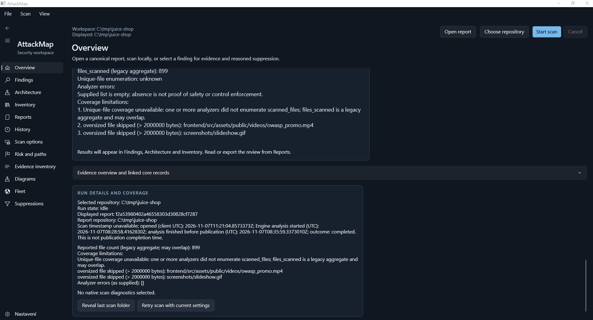
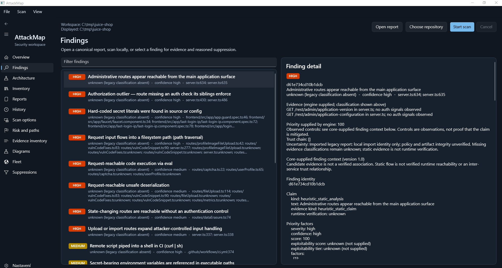
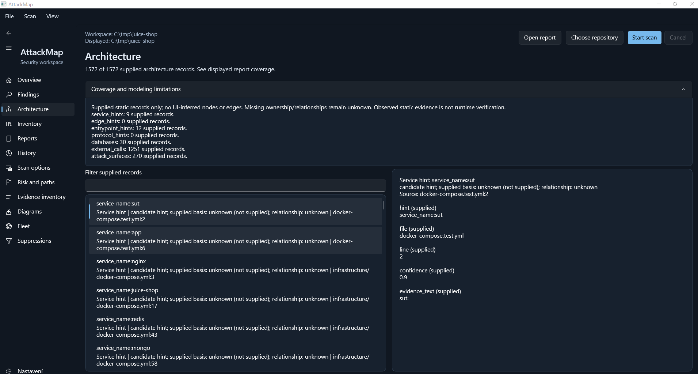
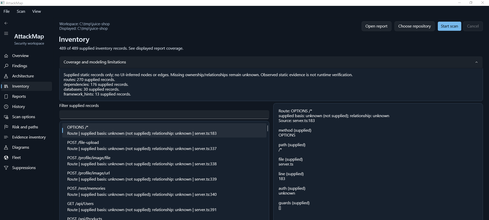
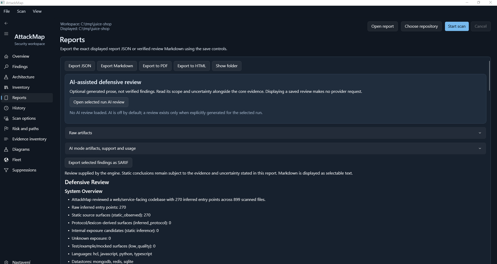
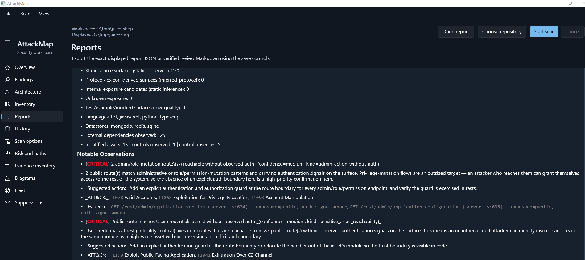
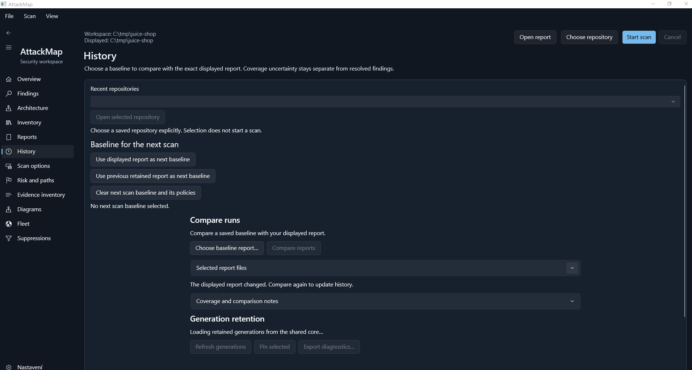
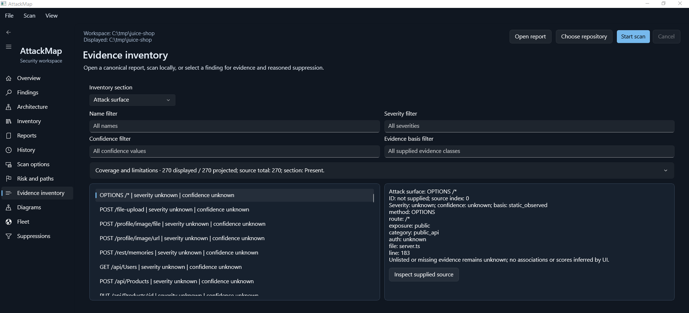
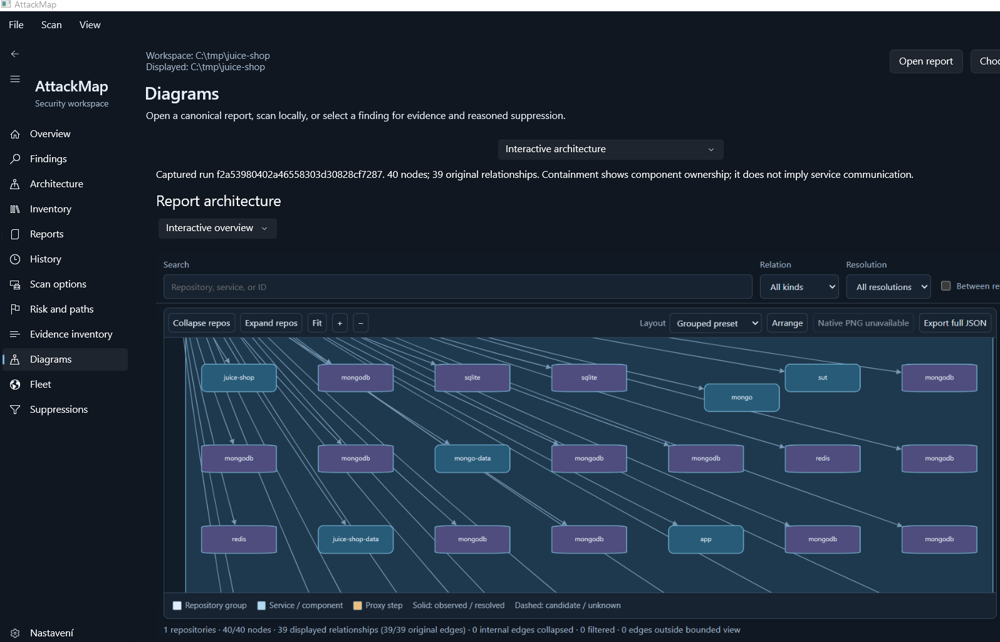

# Windows desktop: completed Juice Shop report

Nine unedited, user-provided screenshots show the Windows application in its
Dark theme with an imported, completed OWASP Juice Shop report:
`f2a53980402a46558303d30828cf7287`. The application is idle while the saved
results are explored. Static-analysis uncertainty and coverage notices remain
visible throughout the workflow.

## 1. Overview

Run identity, completion status and coverage notices appear together. The
reported 899 files are a legacy aggregate; the unique-file count is unknown.
The view also records oversized-file exclusions.

## 2. Findings and source evidence

Engine-supplied severity, confidence and source references appear alongside
the selected administrative-route finding. Its detail pane preserves the
imported report's evidence context and uncertainty notices.

## 3. Architecture

The architecture view presents 1,572 supplied records, including service
hints, datastore records and external calls, with source details for the
selected entry.

## 4. Inventory

The inventory contains 489 supplied records: 270 routes, 176 dependencies,
30 datastore records and 13 framework hints. The selected `OPTIONS /*` route
points to `server.ts:183`.

## 5. Reports and export controls

The core defensive review appears with JSON, Markdown, PDF, HTML and SARIF
export controls. The optional AI review has its own panel and is not loaded
in this view.

## 6. Review observations and recommendations

Prioritized observations and recommended controls retain source citations and
ATT&CK mappings within the static-analysis review.

## 7. History and comparison workflow

The History page brings together baseline selection, comparison and retention
controls. The retention section is shown while loading; no comparison result
is displayed.

## 8. Evidence inventory

The evidence inventory lists 270 supplied attack-surface records with name,
severity, confidence and evidence-basis filters, plus a source inspector.

## 9. Architecture diagram - detail view

Detail of the selected run's graph projection, whose summary reports 40 nodes
and 39 original relationships across one repository. Filters, layout,
expand/collapse and export controls are visible. Containment relationships
describe ownership; service communication requires separate evidence.
