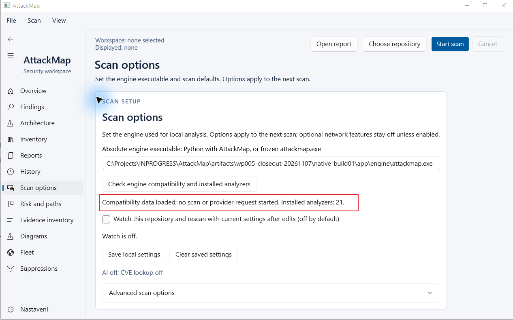
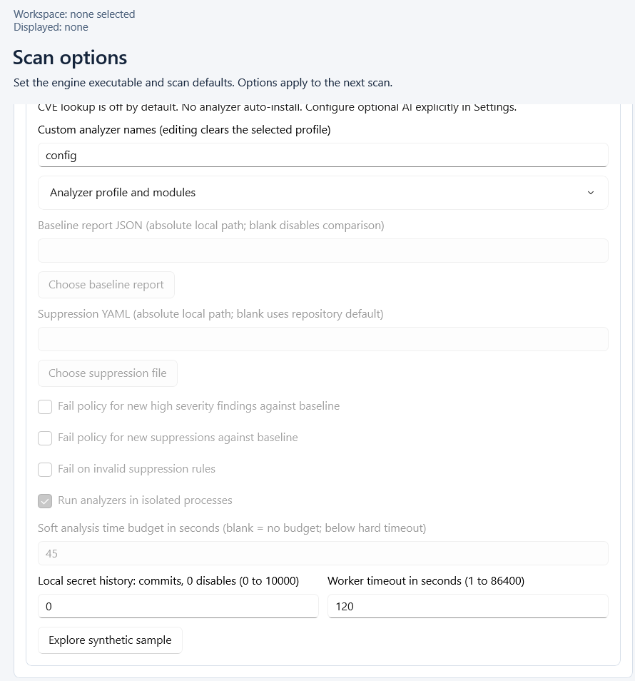
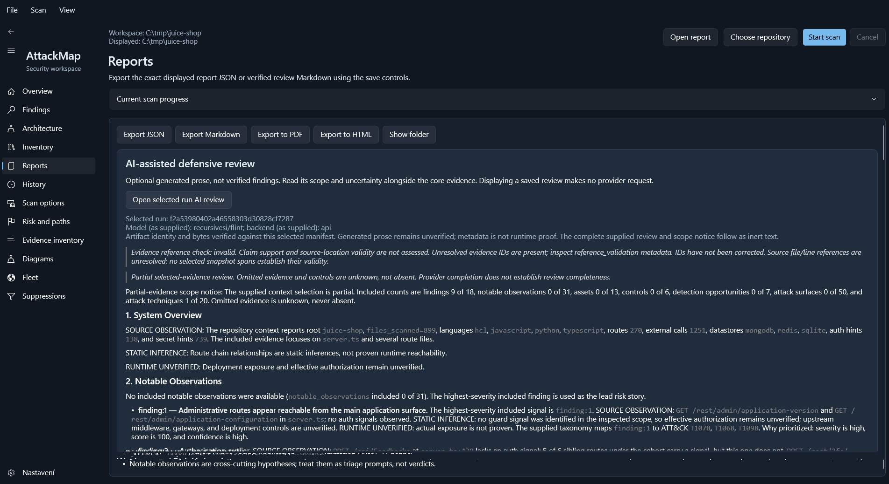

# Windows desktop screenshots

These unedited, user-provided screenshots show the manually operated WP005
Windows application. They were captured with the earlier engine whose SHA-256
starts `e5de74f1`; they are **not a visual test of the latest portable package**
with engine `78857285`. Dimensions below describe the supplied images, not
necessarily the whole application window.

## Scan options and engine compatibility

**1266 × 792 pixels.** The Light theme shows the selected engine path and
loaded compatibility information for 21 installed analyzers. AI and CVE
options are off. Loading compatibility information does not start a repository
scan or a provider request.

## Advanced scan options

**890 × 954 pixels; user-provided crop.** The visible options include the
explicit `config` module, baseline and suppression settings, a checked analyzer
isolation option, a 45-second soft budget and a 120-second hard timeout.
Several controls appear greyed out; this image alone does not establish why
or demonstrate their behavior.

## Reports and saved AI review

**1903 × 1039 pixels.** The Dark theme Reports page shows JSON, Markdown, PDF
and HTML export controls and the saved AI review for run
`f2a53980402a46558303d30828cf7287`, with the supplied model
`recursivesi/flint` and API backend. The displayed status says the selected
artifact identity and bytes were verified; this does not validate the model's
claims. The optional AI prose remains separate from the verified core report
and its Markdown export. Visible notices identify partial context and invalid
or unresolved evidence references.

The user confirmed that the apparent text artifacts at the bottom of this
image came from the screenshot program, while the application itself was
displaying correctly. They are not reported here as an application layout bug.

These images illustrate the shown workflows only; they do not establish
complete rendering, accessibility, clean-host or release acceptance.
