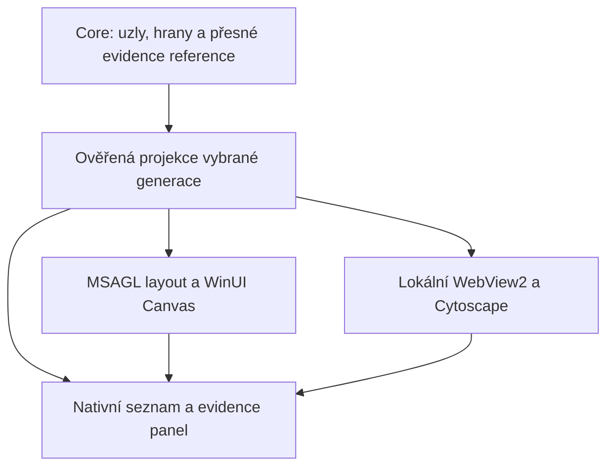

# Canvas + MSAGL proti Cytoscape.js — použití v AttackMap

**Rozšíření požadavku 23. 10.:** cílem je [celé schéma 16 repozitářů](fleet16-requirements.md), včetně repo skupin, služeb, komponent a přesných mezi-repo vazeb. Oba kandidáti proto dostanou stejně prioritní compound/cluster spike; dřívější nativní preference níže je podklad pro portable tradeoff, nikoli závěr pro tento širší scénář. WP043 má fleet povinně, data dodá WP044. Collapse/expand ani agregaci evidence nedodává samotná existence skupin v knihovně.

Datum: 23. 10. 2026. Navazující výzkum k WP043 podle výslovného zadání uživatele. Jde o návrh integrace podložený zdroji a metadata, nikoli implementovaný nebo benchmarkovaný renderer. Nebyl spuštěn build, GUI, scan, model ani instalace závislostí.

## Doporučení

Pro současný Windows produkt a full portable distribuci má jako první kandidát smysl **WinUI Canvas + MSAGL**. Zachová existující nativní plochu, textovou alternativu a životnost výběru; MSAGL nahradí pevnou mřížku výpočtem rozložení podle vztahů. Nativní ovládání, výběr a evidence panel zůstávají odpovědností AttackMap.

**Cytoscape.js ve WebView2** je silný druhý kandidát, jestliže prioritu dostanou bohatší interakce a možnost sdílet grafovou plochu s jinými klienty. Má více hotových grafových funkcí, ale aplikace převezme správu browser runtime, zprávového rozhraní, lifecycle a offline distribuce. Toto pořadí je inženýrské doporučení podle zdejšího produktu, nikoli výsledek měření rychlosti nebo kvality layoutu.

Nejde o dvě stejně rozsáhlé knihovny: **MSAGL dodává hlavně geometrii; Cytoscape dodává grafovou vizualizaci s interakcemi.** MSAGL má oddělené WPF/WinForms viewery; nejsou hotovým WinUI 3 controlem. NuGet `Msagl 1.2.1` je layout-only `.NET Standard 2.0` balíček. [MSAGL](https://github.com/microsoft/automatic-graph-layout), [balíček 1.2.1](https://www.nuget.org/packages/Msagl/1.2.1).

## Praktické porovnání

| Oblast | WinUI Canvas + MSAGL | Cytoscape.js + lokální WebView2 |
| --- | --- | --- |
| Využití dnešního kódu | Zachová se `DiagramView`, ScrollViewer a nativní theme/evidence ovládání; nový adapter pro polohy a trasy hran. | Zachová se shell a native evidence panel; grafová plocha se nahradí vloženým WebView2 a zprávovým adaptérem. |
| Co je nutné doprogramovat | Kreslení křivek/šipek, hit testing, selection, filtrování, focus, graph navigace a grafický export. Některé viewport/text funkce už máme. | Propojení vybraného reportu, typových filtrů a evidence na knihovní API; vlastní bezpečný host, zprávy, theme a lifecycle. |
| Přístupnost | Lze využít WinUI controls a AutomationPeers; samotný Canvas/Border neřeší celou keyboard/Narrator navigaci. | Vizuální graf nenahrazuje přístupný seznam. Nativní tabulka uzlů/hran a ovládání zůstanou součást produktu. |
| Rozsah grafu | Výpočet layoutu a počet XAML prvků jsou různé náklady. Nový layout sám nevyřeší velké množství Shapes/TextBlocks. | Rendering a JS layout mají vlastní náklady; úpravy stylu/labelů a zvolený layout mohou rozhodovat více než počet uzlů. |
| Přerušení práce | Worker Task nezaručuje tvrdé zastavení výpočtu; zvolená MSAGL API musí skutečně předat cancellation do algoritmu. | Standardní Dagre adapter počítá synchronně. `Promise`, timer ani `layout.stop()` nezaručují jeho přerušení. |
| Full portable | Přidáváme layout knihovnu a její notices; browser runtime není potřeba. Přesný přírůstek balíčku dosud neměřen. | Je nutný dostupný WebView2 Runtime, nejen SDK DLL. Evergreen a přibalený Fixed Version mají různé distribuční náklady. |
| Další platformy | WinUI vykreslení je platformní; samotný datový kontrakt se může sdílet. | Lze navrhnout sdílené JS assets; Mac má vlastní WKWebView host/bridge a samostatnou acceptance. |
| Licence | MSAGL MIT; ověřit přesnou distribuovanou verzi a closure. | Cytoscape a posuzovaný Dagre adapter MIT; ověřit i přibalené části a browser runtime notices. |

Cytoscape umí JSON graf, selection/event API, viewport a obrazové exporty; typové filtry a otevírání evidence navrhne AttackMap. [Cytoscape API](https://js.cytoscape.org/). Podrobné technické podklady: [nativní integrace](msagl-integration.md), [Cytoscape/WebView2 integrace](cytoscape-integration.md).

## Společný základ obou variant

Nejdřív potřebujeme strukturovaná data grafu od core. Současný canonical report nemá plný serializovaný `ServiceGraph`; renderer tuto mezeru nespraví. Staré Mermaid artefakty mohou zůstat jako bezpečný display fallback bez domyšlených evidence vazeb.

Navržená hranice WP043:

Jde o alternativní renderery stejné projekce, nikoli návrh zapnout oba v produktu. Datový kontrakt ponese stabilní IDs, druh/směr vztahu, případnou basis/confidence/provenance a explicitní evidence refs. Host přidá kontext vybraného run/generation a ověřený report hash z existujícího envelope; report nemusí obsahovat hash vlastních ještě neserializovaných bajtů.

Kliknutí na uzel nebo hranu předá pouze známé ID a context token. Nativní vrstva ho ověří proti právě zobrazenému modelu a sama otevře správný finding/source. Žádné spojování podle názvů, odvozování vztahů z `via`, vlastní scoring ani vykonávání reportových URL.

## Jak použít nativní variantu

1. Změřit popisky/boxy ve WinUI v DIPs; pracovnímu layoutu předat čistá data, nikoli UI objekty.
2. Adapter vytvoří MSAGL geometry graph a zvolí layered layout pro orientovanou topologii. Worker vrátí pozice, bounding boxes, křivky, šipky a label placement dostupné ze zvoleného API.
3. `DiagramView` promítne geometrii do Canvas souřadnic, vykreslí uzly a hrany a naváže ID na detail panel. Nativní seznam poskytne keyboard přístup ke stejným datům.
4. Každý výpočet má zachycenou revision/generation; po přepnutí reportu nebo zavření se pozdní výsledek odmítne. Změna tématu nemusí měnit fakta ani znovu počítat layout; změna rozměrů textu může layout invalidovat.

Nejmenší samostatný řez lze ověřit na již přijatém inertním `DiagramDocument`: nahradit pouze `DiagramLayout.Positions` a zjednodušené vedení hran. Tím zlepšíme rozložení stávajících diagramů, ale nevznikne nová evidence identita ani podpora dosud odmítané Mermaid syntaxe. Full explorer dál potřebuje společný kontrakt.

## Jak použít Cytoscape

1. Zabalit pevně verzované HTML/JS/CSS přímo do aplikace a otevřít je ve WinUI `WebView2` přes lokální virtual host. Node.js ani lokální HTTP server nejsou nutnou runtime součástí tohoto návrhu.
2. Po inicializaci dokumentu poslat ověřený graph DTO jako JSON; JS mapuje core IDs na element IDs. Zpráva zpět obsahuje jen povolenou akci, ID a context token. Host řídí výběr reportu i native evidence panel.
3. Malý podporovaný graf může začít Dagre layoutem. Pro větší graf musí návrh řešit práci mimo hlavní JS thread: například vlastní Dagre Worker vrátí polohy a Cytoscape je zobrazí přes `preset`. Je to vlastní integrační práce, nikoli vlastnost standardního adaptéru.
4. Na změnu reportu zavřít/přerušit vlastní práci a odmítnout starý context. Samostatně řešit resize, theme/high contrast, zavření WebView, writable user-data folder a obnovu po selhání rendereru.

Aktuální upstream dokumentace Dagre adaptéru uvádí přibalený Dagre v distribuovaném souboru a volitelný přenos jeho control points pro hrany. Přesné verze se před spike zamknou; nelze přebírat assumptions ze staršího adaptéru nebo považovat current master za otestovaný release. [Dagre adapter](https://github.com/cytoscape/cytoscape.js-dagre).

## Důležitý dopad na dnešní portable

Aktuální projekt už má WebView2 SDK tranzitivně přes WindowsAppSDK. Přečtený `obj/project.assets.json` obsahuje `Microsoft.Web.WebView2/1.0.3719.77`; uchovaný native integration02 publish obsahuje Core, Projection a Loader DLL. To **neprokazuje přítomnost browser runtime** v portable ani funkčnost WebView controlu.

Přesné hashe a rozsah této read-only kontroly: [renderer-source-snapshot.json](renderer-source-snapshot.json).

Microsoft rozlišuje Evergreen Runtime a vlastní Fixed Version. Fixed runtime má přes 250 MB binárních souborů, samostatnou aktualizační odpovědnost a omezení pro unpackaged Windows 10/UNC; nejde o změřený přírůstek komprimovaného ZIPu AttackMap. Plně offline použitelný balíček proto vyžaduje konkrétní distribuční a clean-host rozhodnutí. [WebView2 distribuce](https://learn.microsoft.com/en-us/microsoft-edge/webview2/concepts/distribution). UDF musí být zapisovatelný a oddělený od neměnného payloadu. [User data folders](https://learn.microsoft.com/en-us/microsoft-edge/webview2/concepts/user-data-folder).

## Co rozhodne krátký spike

Obě plochy dostanou stejný zmrazený model: 100/300 a 1000/3000 node/edge varianty, plus 10000/30000 stress pro explicitní fallback. Zahrnout cykly, multiedges, oddělené komponenty, dlouhé názvy, candidate/proxy vazby a nepřítomnou evidenci.

Vyhodnotit přesnou shodu uzlů/hran/evidence, čitelnost, finding → graf → důkaz → back, klávesnici/Narrator, Light/Dark ve dvou velikostech, layout čas, odezvu, peak paměť, cancel/close a velikost nového payloadu. Číselné supported limity stanoví měření; nejde o obnovení Windows C26. Hotové screenshots se musí skutečně prohlédnout.

Zvolit **jednu** produkční plochu. Pokud nativní varianta splní potřebné interakce a zvolený rozsah bez nepřiměřené vlastní infrastruktury, zůstane první volbou pro Windows portable. Pokud ne a Cytoscape přinese doloženou výhodu, jeho volba zahrne offline runtime a bridge jako plnohodnotnou součást WP043/WP024/WP025. Tento výzkum knihovnu nepřidává a WP043 zůstává OPEN.
