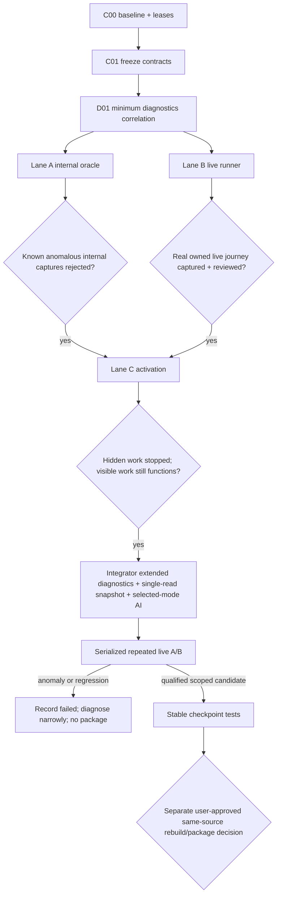

# WP043 continuation — exact implementation checklist

**Date:** 2026-10-25
**Goal:** Make rendering evidence truthful, reproduce and stabilize the real shell journey, then reduce shell work without presenting a lifecycle/performance change as a proven glyph repair.
**Architecture:** Keep the current WinUI modular-monolith shell, canonical Python engine, manifest-bound artifacts, Cytoscape/fCoSE + Canvas/MSAGL renderer choice, and Windows App SDK 2.4.0. Add a pure capture oracle, an independent live-window runner, effective-visibility activation, and a single-read report snapshot. Do not introduce CQRS, event sourcing, a daemon, a database, a new renderer, or an SDK upgrade in this sequence.
**Tech stack:** C# / .NET 8 / WinUI 3, existing console-test projects, Python `unittest`/`pytest`, Win32 + UI Automation for live QA, JSON/JSONL evidence.

This document is execution detail subordinate to active WP043. It does not replace `docs/windows-parity-todo.md`, the roadmap, or the JSON backlog. WP043/WP044 remain `IN_PROGRESS`; Windows M3 remains accepted only in its recorded scope; Windows C26 is not reinstated.

## 1. Current behavior that the plan is based on

- `MainWindow.Capture.cs:152-234` can write `capture-manifest.json` after black or glyphless output. It does not request content validation and has no text-region oracle.
- `NativeCaptureProbe.cs:19-98` waits two rendering frames. Its optional check accepts any nonzero RGB pixel and cannot establish that text was rendered.
- Internal `RenderTargetBitmap` output is not independent live-window evidence. Five SDK 2.4.0 and five SDK 2.5.1 runs each contained at least one anomaly per set. SDK 2.5.1 is not a repair candidate on that evidence.
- `MainWindow.xaml` retains destination panels and navigates with `Visibility`. `DiagramWorkspaceView.cs:61-68` and `GraphWebView.cs:110-145` check local visibility, not collapsed ancestors.
- `MainWindow.xaml.cs:412-456` reads/parses the same report through three adapters. `MainWindow.Parity.cs:125-134` eagerly binds hidden destinations. `AI/AiArtifactProjection.cs:121-149` reads all AI modes.
- `MainWindow.RenderDiagnostics.cs` already supplies opt-in JSONL state, ancestor visibility, WebView2 core counts, `SurfaceContentsLost`, and F9/F10 probes. Reuse it; do not create a competing telemetry stream.
- No cross-thread XAML write, `SurfaceContentsLost`, WebView2 failure, F9/F10 dispatch, or other low-level root cause is established. Hidden-view activation and report I/O are credible risks, not proven causes of glyph loss.

## 2. Non-negotiable evidence vocabulary

Every new result must use these exact scopes:

| Value | Meaning |
|---|---|
| `not-run` | The required action was not executed. |
| `failed` | The action ran and its scoped check failed. |
| `internal-capture-passed` | Required internal PNGs passed the automated oracle; no live acceptance implied. |
| `independent-live-window-captured` | The owned, foreground, unoccluded real window was captured with acknowledged navigation; pixels still require review. |
| `manual-review-passed` | A named reviewer actually inspected every required image and recorded no anomaly in the reviewed scope. |
| `not-reproduced` | The specified valid runs completed without observing the target anomaly; this is not a repair claim. |
| `discarded-invalid` | The capture violated ownership, foreground, occlusion, generation, or acknowledgment requirements and is excluded from coverage. |
| `not-established` | Root cause, repair efficacy, release acceptance, or another claimed conclusion lacks evidence. |

Rules:

1. A manifest, exit code, UI Automation text value, geometry, white foreground, layout acknowledgment, or successful PNG write is not glyph proof.
2. A failed capture remains in the run and fails that run even if a later capture passes. Never delete an anomaly or retry until it disappears without retaining every attempt.
3. An occluded, minimized, wrong-process, wrong-generation, or unacknowledged-navigation image is `discarded-invalid`, not a product failure and not valid evidence.
4. Automated live capture ends at `independent-live-window-captured`. Only actual image review can set `manual-review-passed`.
5. `RenderTargetBitmap` and live-window results are reported separately. Neither is silently promoted to C24/C25, WP043, WP044, package, or release acceptance.
6. No scan or provider call is needed for this sequence. Use the complete retained generation read-only. Do not contact LM Studio.
7. Do not modify retained evidence or fixtures. Every run uses a new empty directory under `artifacts/diagram-integration-20261024/wp043-continuation-20261025/`.

## 3. Parallel execution and exclusive leases

Maximum concurrency is one integrator plus three implementation agents. Implementation agents use `gpt-6.1-sol` when the user explicitly dispatches them. No agent edits outside its lease. The integrator applies shared-file changes sequentially.

| Owner | Exclusive files |
|---|---|
| **Integrator** | `desktop/windows/AttackMap.NativeSpike/MainWindow.xaml`; all `MainWindow.*.cs`, including `MainWindow.Capture.cs`, smoke partials, and `MainWindow.RenderDiagnostics.cs`; `ReportAdapter.cs`; `ReportSectionAdapter.cs`; `Overview/ParityOverviewAdapter.cs`; `Overview/OverviewView.cs`; `MarkdownView.cs`; `ExportSelection.cs`; new `VerifiedReportSnapshot.cs`; `AI/AiArtifactProjection.cs`; `AI/AiArtifactsView.cs`; `ReportAdapter.Tests/`; `ReportSections.Tests/`; `ParityOverview.Tests/`; `AiArtifacts.Tests/`; new `ReportSnapshot.Tests/`; `tools/test_wp043_native.ps1`; integration evidence |
| **Lane A — capture truth** | `desktop/windows/AttackMap.NativeSpike/NativeCaptureProbe.cs`; new `desktop/windows/AttackMap.NativeSpike/CaptureOracle.cs`; new `desktop/windows/CaptureOracle.Tests/CaptureOracle.Tests.csproj`; new `desktop/windows/CaptureOracle.Tests/Program.cs` |
| **Lane B — independent live journey** | new `tools/capture_wp043_live.py`; new `tests/test_wp043_live_capture.py`; new `docs/verification/windows-parity/WP043/diagram-integration-20261024/LIVE-CAPTURE-PROTOCOL.md` |
| **Lane C — predictable activation** | `desktop/windows/AttackMap.NativeSpike/Diagram/DiagramWorkspaceView.cs`; `Diagram/DiagramView.cs`; `Graphs/GraphWebView.cs`; `Fleet/FleetGraphPane.cs`; new `desktop/windows/AttackMap.NativeSpike/UiActivation.cs` |

Additional rules:

- Lane A does not edit `MainWindow.Capture.cs`; the integrator consumes the frozen API from §4.
- Lane C does not edit constructor dispatch or add a smoke mode. It exposes the internal counters in §4; the integrator adds the full-shell activation smoke.
- Lane B owns no application source. Navigation acknowledgment uses the existing diagnostics JSONL contract plus the integrator-added correlation fields in D01 and I01.
- Production `.csproj` files are not leased. New production files are included by default globbing. Keep Windows App SDK `2.4.0` unchanged.
- Existing dirty changes are part of the baseline. No reset, clean, stash, checkout, broad formatting, or whole-file revert is permitted.
- Do not commit by default. If the user separately requests commits, review and stage only task-owned hunks with `git add -p`; whole-file `git add` on a pre-existing dirty file can capture somebody else's work.

## 4. Frozen cross-lane contracts

Freeze these names before parallel edits. A change requires integrator review and a consumer search.

```csharp
// CaptureOracle.cs — pure net8.0-compatible code; no WinUI or Windows Runtime types.
namespace AttackMap.NativeSpike;

public sealed record CaptureRegion(
    string Name, double X, double Y, double Width, double Height,
    byte ForegroundR, byte ForegroundG, byte ForegroundB);

public sealed record CaptureRegionAssessment(
    string Name, int Width, int Height, int SampledPixels,
    int InkPixels, double InkRatio, string? Failure);

public sealed record CaptureAssessment(
    bool Passed, string? Failure,
    int NonBlackPixels, IReadOnlyList<CaptureRegionAssessment> Regions);

public static class CaptureOracle
{
    public const int MaxBytes = 128 * 1024 * 1024;
    public static CaptureAssessment Evaluate(
        ReadOnlySpan<byte> bgra, int width, int height,
        double scale, IReadOnlyList<CaptureRegion> requiredText);
}

public sealed record CaptureAttempt(string Name, string Outcome, string? Error);

public sealed class CaptureRunState
{
    public CaptureRunState(int expected);
    public IReadOnlyList<CaptureAttempt> Attempts { get; }
    public int Succeeded { get; }
    public int Failed { get; }
    public string Status { get; } // incomplete, failed, internal-capture-passed
    public void Success(string name);
    public void Failure(string name, string error);
}
```

```csharp
// NativeCaptureProbe.cs public surface consumed by the integrator.
public static Task<CaptureMetadata> Capture(
    FrameworkElement root, string absolutePngPath,
    bool requireVisibleContent = false,
    IReadOnlyList<CaptureRegion>? requiredText = null);

public static CaptureRegion RequireTextRegion(
    FrameworkElement root, TextBlock text, string name);
```

`CaptureMetadata` gains `CaptureAssessment Assessment`. A new `CaptureValidationException : InvalidDataException` exposes `CaptureMetadata Metadata`. The probe writes and hashes the anomalous PNG before throwing that exception. Any `requireVisibleContent: true` call with no `requiredText` fails fast: RGB-only validation is no longer an accepted strict mode.

```csharp
// UiActivation.cs — called only on the owning UI thread.
public static class UiActivation
{
    public static bool IsEffectivelyVisible(FrameworkElement element);
}
```

The visibility predicate requires `IsLoaded`, nonzero current dimensions, `Visibility.Visible`, and the same visibility/dimension conditions for every `FrameworkElement` ancestor through the visual tree. Opacity is recorded for diagnostics but is not treated as a visibility substitute.

Lane C exposes these QA-only readbacks without changing public engine contracts:

```csharp
// DiagramView
internal int SelectionLoadCount { get; }

// DiagramWorkspaceView
internal int GraphLoadCount { get; }
internal int LegacySelectionLoadCount { get; }

// GraphWebView
internal int InitializationAttemptCount { get; }
internal int CoreInitializationCount { get; }

// FleetGraphPane forwards the nested GraphWebView counters.
internal int InteractiveInitializationAttemptCount { get; }
internal int InteractiveCoreInitializationCount { get; }
```

## 5. Dependency graph and stop gates



**Stop conditions:** do not start Lane C product edits until the oracle can reject the retained black and glyphless samples and the live runner has produced at least one valid, acknowledged baseline journey. If the baseline live journey reproduces glyph loss, preserve it and diagnose that observation; do not relabel the activation patch as the established fix. If no live anomaly reproduces, record `not-reproduced`, keep the user report open, and continue only with the separately justified lifecycle/performance changes.

---

# Phase 0 — identity and contracts

## C00 — Record the mutable baseline and leases (integrator)

- [ ] Create a new evidence root without altering existing artifacts:

```powershell
$evidence = 'artifacts/diagram-integration-20261024/wp043-continuation-20261025'
New-Item -ItemType Directory -Path $evidence -ErrorAction Stop
git rev-parse HEAD | Set-Content "$evidence/head.txt"
git status --short | Set-Content "$evidence/git-status.txt"
git diff --stat | Set-Content "$evidence/tracked-diff-stat.txt"
git diff | git hash-object --stdin | Set-Content "$evidence/tracked-diff-hash.txt"
git ls-files --others --exclude-standard | Set-Content "$evidence/untracked-files.txt"
```

- [ ] Record SHA-256 for the tested `native-07` EXE/DLL, the retained report and manifest, and every candidate binary used later. Record source path, runtime path, package path, and installed path as separate identities. In `baseline-hashes.json`, record the verified engine source path as `engine.source_path`; L03 reads this property rather than guessing an engine path.
- [ ] Confirm the retained report generation remains complete and read-only. Expected retained report prefix from the handoff is `f6ba35b3f2ac47d397d82d3a81849dfc`; verify the actual full hash rather than inventing the remainder.
- [ ] Confirm `AttackMap.NativeSpike.csproj` and `GraphExplorer.NativeView.csproj` still reference `Microsoft.WindowsAppSDK` `2.4.0`.
- [ ] Write `leases.json` with the four owners and exact files from §3. Record `base_head`, `tracked_diff_hash`, start time, and the fact that uncommitted source is intentionally included.
- [ ] Run no build or UI process in this step.

**Acceptance:** baseline files exist; all subsequent evidence names the exact binary and source diff; no pre-existing file changed.
**Checkpoint:** hash the baseline files into `baseline-hashes.json`; no Git commit.

## C01 — Freeze interfaces and consumer inventory (integrator + lane owners, read-only)

- [ ] Add §4 verbatim to each agent's assignment.
- [ ] Search all `NativeCaptureProbe.Capture`, `Diagrams.SetSelection`, `AiArtifactWorkspace.Load`, and adapter `Load` consumers before editing signatures.
- [ ] Assign only new files to parallel agents; shared call-site migration remains with the integrator.
- [ ] Record the consumer inventory as `consumer-inventory.txt` in the new evidence root.

**Acceptance:** every changed public/internal signature has a named consumer owner; no two owners share a write lease.

## D01 — Add the minimum live-acknowledgment correlation (integrator, before B02)

Files: `MainWindow.RenderDiagnostics.cs`, `MainWindow.xaml.cs` only.

- [ ] Add one random `runId` to every JSONL event. Add `navigationRevision`, incremented once for each accepted `Navigate` call, and include it in `navigation-after-turn`.
- [ ] Include the current `displayedRun`, `displayedReadHash`, `generation`, `rootTheme`, selected destination, and heading in every navigation snapshot. Empty hash before report load is not acknowledgment.
- [ ] Emit `finding-selection` with run/generation/report hash/navigation revision and `findingRevision`; do not include finding text or source content.
- [ ] Keep the existing `navigation-after-turn` event name and nested `navigation`/`heading` shape so the live tool has one stable contract. F9/F10 event names remain unchanged until I01 extends their mutation detail.
- [ ] Build an instrumented baseline **before Lane C or report/AI changes** and record its EXE/DLL hashes:

```powershell
& ./.tools/dotnet/dotnet.exe publish desktop/windows/AttackMap.NativeSpike/AttackMap.NativeSpike.csproj `
  --configuration Release --runtime win-x64 --self-contained true `
  --output artifacts/diagram-integration-20261024/wp043-continuation-20261025/live-instrumented-baseline `
  -p:NuGetAudit=false
```

**Acceptance:** build zero errors; a diagnostics-only baseline binary exists; no lifecycle, report-adapter, AI, renderer, SDK, or package behavior changed.

---

# Lane A — make internal evidence truthful

## A01 — Write failing pure-oracle tests first (Lane A)

Create `desktop/windows/CaptureOracle.Tests/CaptureOracle.Tests.csproj`:

```xml
<Project Sdk="Microsoft.NET.Sdk">
  <PropertyGroup>
    <OutputType>Exe</OutputType>
    <TargetFramework>net8.0</TargetFramework>
    <ImplicitUsings>enable</ImplicitUsings>
    <Nullable>enable</Nullable>
  </PropertyGroup>
  <ItemGroup>
    <Compile Include="../AttackMap.NativeSpike/CaptureOracle.cs" Link="CaptureOracle.cs" />
  </ItemGroup>
</Project>
```

- [ ] Create `Program.cs` with the existing console-test `Check(bool, string)` pattern and synthetic BGRA buffers.
- [ ] Cover all cases below with exact assertions, not snapshots:

| Case | Expected result |
|---|---|
| all-black BGRA | `Passed == false`, failure `no-visible-rgb` |
| nonblack decoration outside required text region | global content exists, region fails `missing-text-ink` |
| valid white text ink on dark dominant background | passes |
| valid black text ink on light dominant background | passes |
| antialiased text near region edge | passes without requiring every pixel to match foreground |
| region with foreground/background contrast below 48 levels | fails `insufficient-foreground-contrast` |
| empty text-region list in strict evaluation | fails `text-regions-required` |
| negative, zero, NaN, infinite, wrong-scale region | fails `invalid-region` |
| region outside or clipped by pixel bounds | fails `region-out-of-bounds`; never silently clips |
| width/height `<= 0`, `> 16384`, or byte count `> MaxBytes` | fails before pixel iteration |
| BGRA length different from `width * height * 4` | fails `invalid-buffer-length` |
| one failed attempt followed by one success | `CaptureRunState.Status == "failed"`; both attempts retained |
| expected two successes but only one recorded | status `incomplete` |
| expected two successes with no failure | status `internal-capture-passed` |

- [ ] Keep retained PNGs read-only. Do not add an imaging dependency solely to replay them: synthetic buffers prove oracle logic, while A05 evaluates fresh captures. Never pretend synthetic buffers reproduce the intermittent WinUI glyph-loss mechanism.

Run the red test and retain the expected compile failure because `CaptureOracle.cs` does not yet exist:

```powershell
$env:DOTNET_ROOT = "$PWD/.tools/dotnet"
$env:DOTNET_CLI_HOME = "$PWD/.tools/dotnet-home"
$env:NUGET_PACKAGES = "$PWD/.tools/nuget-packages"
& ./.tools/dotnet/dotnet.exe run --project desktop/windows/CaptureOracle.Tests/CaptureOracle.Tests.csproj --configuration Release -p:NuGetAudit=false
```

**Expected red result:** `CS2001` or missing project source for `CaptureOracle.cs`.
**Checkpoint:** retain `a01-red.txt`; no production implementation yet.

## A02 — Implement the bounded pure oracle (Lane A)

- [ ] Create `CaptureOracle.cs` with the §4 records and validation.
- [ ] Convert logical region coordinates to pixels with `Floor(left/top)` and `Ceiling(right/bottom)` after multiplying by scale. Permit only rounding tolerance of one pixel at the outer image edge; reject substantive clipping.
- [ ] Validate dimensions before `width * height * 4` using `long`; never allocate inside the oracle.
- [ ] Count a global nonblack pixel only when alpha is greater than 16 and at least one RGB channel is greater than 8.
- [ ] For each required region, find the dominant quantized RGB background (16-level bins). Require at least 48 levels of maximum-channel contrast between supplied foreground and dominant background.
- [ ] Count ink only for pixels at least 32 RGB distance levels from background and closer to the expected foreground than to background. Require `max(8, ceil(sampledPixels * 0.002))` ink pixels. Store counts and ratio so thresholds can be reviewed from evidence.
- [ ] Keep this a **required-text-region ink oracle**, not OCR and not proof that every glyph is correct. OCR may be added later only as secondary evidence.

Use this exact run-state implementation to prevent retry erasure:

```csharp
public sealed class CaptureRunState
{
    private readonly List<CaptureAttempt> attempts = [];
    public CaptureRunState(int expected)
    {
        if (expected <= 0) throw new ArgumentOutOfRangeException(nameof(expected));
        Expected = expected;
    }
    public int Expected { get; }
    public IReadOnlyList<CaptureAttempt> Attempts => attempts;
    public int Succeeded => attempts.Count(a => a.Outcome == "passed");
    public int Failed => attempts.Count(a => a.Outcome == "failed");
    public string Status => Failed > 0 ? "failed" :
        Succeeded == Expected ? "internal-capture-passed" : "incomplete";
    public void Success(string name) => attempts.Add(new(name, "passed", null));
    public void Failure(string name, string error) =>
        attempts.Add(new(name, "failed", string.IsNullOrWhiteSpace(error) ? "unspecified capture failure" : error));
}
```

- [ ] Re-run A01. Expected: `PASS 13 capture oracle checks; synthetic BGRA only; no GUI or live acceptance.` Use the actual check count if additional assertions are grouped; the final line must retain the synthetic/no-GUI scope.
- [ ] Run a second time and require identical output.

**Acceptance:** all synthetic cases pass; malformed input fails closed; no WinUI reference enters the pure file.

## A03 — Make `NativeCaptureProbe` retain and report anomalies (Lane A)

- [ ] Keep existing path, reparse-point, size, PNG-encoding, and owning-thread checks.
- [ ] Extend `CaptureMetadata` with `CaptureAssessment Assessment` and add `CaptureValidationException.Metadata`.
- [ ] Replace the two-frame-only settle with: one low-priority dispatcher turn, `UpdateLayout`, a 250 ms layout-quiet wait bounded to 5 seconds, then three `CompositionTarget.Rendering` frames bounded to 3 seconds. A timeout writes no success result.
- [ ] Add `RequireTextRegion`: require nonempty `TextBlock.Text`, loaded/effective visibility, positive bounds fully inside `root`, and a `SolidColorBrush`. Use `TransformToVisual(root).TransformBounds(...)`; return logical bounds plus foreground RGB. Do not include the text body in the region name or evidence.
- [ ] After pixels are available, encode/write/hash the PNG first, evaluate second, and return metadata or throw `CaptureValidationException` with that metadata. Thus black/glyphless samples remain available for diagnosis.
- [ ] Update `Scope` to say that required-region ink was checked but correctness of all glyphs and live-window rendering remain unproven.

**Focused build:**

```powershell
& ./.tools/dotnet/dotnet.exe build desktop/windows/AttackMap.NativeSpike/AttackMap.NativeSpike.csproj --configuration Release -p:NuGetAudit=false
```

**Expected:** build succeeds only after the integrator migrates strict callers; if compile migration is still pending, retain the exact consumer errors and hand them to the integrator rather than weakening the API.

## A04 — Migrate capture call sites and fail the run truthfully (integrator, after A03)

Files: `MainWindow.Capture.cs`, `MainWindow.NavigationRenderSmoke.cs`, `MainWindow.DiagramRenderSmoke.cs`, `MainWindow.AnalyzerSmoke.cs`, `MainWindow.FleetGraphSmoke.cs`, `MainWindow.ProviderRenderSmoke.cs`, `MainWindow.ParitySmoke.cs`, `MainWindow.PortableStartupSmoke.cs`, `MainWindow.ProviderScrollSmoke.cs`, `MainWindow.SingleWatchSmoke.cs`.

- [ ] Add one shared `RequiredCaptureRegions(root, activePanel)` helper in `MainWindow.Capture.cs`. It must include `Heading`, the selected navigation label, and at least one nonempty, effectively visible page `TextBlock`. Use stable region names such as `heading`, `selected-navigation`, `page-text-0`; never serialize the text body.
- [ ] For `CaptureLoaded`, await the current parity binding when the destination uses it, assert `root.ActualTheme == root.RequestedTheme`, assert selected destination and `Heading.Text` agree, assert exactly one destination panel is effectively visible, and obtain stable region bounds before capture.
- [ ] Replace each strict `requireVisibleContent: true` call with `requireVisibleContent: true, requiredText: RequiredCaptureRegions(...)`. For previously non-strict QA captures, use strict mode too; do not leave an RGB-only route.
- [ ] In `CaptureLoaded`, compute the expected count before the loop, create `CaptureRunState`, catch `CaptureValidationException` per image, retain its metadata and failure, and continue the journey. Other exceptions are run failures with context.
- [ ] Write `capture-manifest.json` for completed journeys with `status`, `attempts`, `captures`, `expected`, `manual_review = "not-run"`, `live_window_acceptance = "not-established"`, and `acceptedC25 = false`. A failed run also gets `capture-failure.json`; a success manifest can never coexist with an unrecorded capture failure.
- [ ] Apply the same no-hidden-failure rule to `proof.json` and `diagram-proof.json`: `captureFailures.Count > 0` forces scoped failure even when `failure == null`.
- [ ] Remove retry-by-forgetting behavior. `CaptureAnalyzerReview` and fleet equivalents may make repeated attempts only with fresh filenames and one attempt record per image; the original anomaly remains and the run remains failed.

**Acceptance tests:**

1. `CaptureOracle.Tests` remains green.
2. Native project builds with zero errors.
3. Static consumer search shows every strict capture supplies regions:

```powershell
git grep -n "NativeCaptureProbe.Capture" -- desktop/windows/AttackMap.NativeSpike
git grep -n "requireVisibleContent: true" -- desktop/windows/AttackMap.NativeSpike
```

4. A05 rejects every fresh black/glyphless capture it observes. If the intermittent anomaly does not recur, record `not-reproduced`; do not claim the old PNG was replayed or the defect was repaired. A successful manifest alone is never accepted.

## A05 — Replay the same saved generation through internal capture (integrator, serialized UI)

Use a candidate built from the exact current source, SDK 2.4.0, and a fresh output directory. Do not overwrite `native-07`.

```powershell
& ./.tools/dotnet/dotnet.exe publish desktop/windows/AttackMap.NativeSpike/AttackMap.NativeSpike.csproj `
  --configuration Release --runtime win-x64 --self-contained true `
  --output artifacts/diagram-integration-20261024/wp043-continuation-20261025/internal-candidate `
  -p:NuGetAudit=false
$report = 'artifacts/diagram-integration-20261024/source-render-audit-20261025/saved-generation/attackmap-report.json'
$out = 'artifacts/diagram-integration-20261024/wp043-continuation-20261025/internal-oracle-01'
New-Item -ItemType Directory $out
& 'artifacts/diagram-integration-20261024/wp043-continuation-20261025/internal-candidate/AttackMap.NativeSpike.exe' `
  --capture-smoke (Resolve-Path $report) (Resolve-Path $out)
```

- [ ] Run the internal journey five times with fresh directories `internal-oracle-01` through `-05`.
- [ ] Inspect every `1600x1000-Dark` image and all reported anomalies. Automated region ink does not replace review.
- [ ] Verify a synthetic forced-oracle failure retains its PNG and failure record. Use a test-only invalid region in a separate QA run, never a production bypass.
- [ ] Record run counts as `internal-capture-passed`, `failed`, or `not-run`; do not infer that the production defect is fixed.

**Gate A:** the harness no longer reports success for black/glyphless samples, and every anomaly is retained. If this is not true, stop before product lifecycle changes.

---

# Lane B — reproduce the real user journey independently

## B01 — Specify the live protocol and fake-backend tests first (Lane B)

Create `docs/verification/windows-parity/WP043/diagram-integration-20261024/LIVE-CAPTURE-PROTOCOL.md` with this exact journey:

1. Require `--theme dark` for this WP043 journey. Before launch, the tool writes `{"theme":"dark"}` only to the isolated `LOCALAPPDATA/AttackMap/NativePreview/theme.json`; it never reads or changes the personal theme file.
2. Launch the specified EXE with `--show-report <same-retained-report> --render-native-only --render-diagnostics <fresh-trace>`.
3. Isolate `LOCALAPPDATA` and `WEBVIEW2_USER_DATA_FOLDER` under the new run directory; no personal settings and no engine scan.
4. Find the visible top-level window by the launched PID, not title alone. Require exactly one owned `AttackMap` window.
5. Restore if minimized, activate, wait 1 second after restore/placement, then move/resize to 1600×1000. Do not resize while minimized. Require a new diagnostics snapshot with `rootTheme == "Dark"`, the expected report hash, and the selected Findings destination before starting traversal.
6. Before every action and capture require: live process, owned foreground HWND, visible/non-minimized window, expected report hash in diagnostics, and no visible higher-Z-order window intersecting the target rectangle. Cloaked windows are ignored; any other intersecting visible window invalidates the frame conservatively.
7. Locate navigation items through UI Automation, focus the item, send actual Enter with `SendInput`/pywinauto keyboard, then wait for a **new** diagnostics `navigation-after-turn` whose run ID, report hash, navigation revision, selected label, and heading match the request. A key send without acknowledgment is failed dispatch, not navigation.
8. In each of five rounds, traverse exactly `Overview`, `Findings`, `Architecture`, `Inventory`, `Reports`, `History`, `Scan options`, `Risk and paths`, `Evidence inventory`, `Diagrams`, `Fleet`, `Suppressions`, and Settings. Capture only after acknowledgment and a 500 ms post-layout delay. Do not use `RenderTargetBitmap` or frame capture to drive navigation.
9. Immediately after each Findings capture, select the first finding through UI Automation, require a new `finding-selection` event bound to the same run/report/navigation revision, and capture the existing inspector as `FindingDetail`. No new detail destination is invented.
10. Separately exercise Ctrl+H and Ctrl+, and require History/Settings acknowledgment. Exercise F9/F10 only in an explicitly labeled diagnostic run and require their JSONL invocation/application events before making any statement about the intervention.
11. Save `evidence.json`, `stdout.log`, `stderr.log`, diagnostics JSONL, and all valid/discarded capture metadata. Set `status = "independent-live-window-captured"` only when the protocol completed; keep `manual_review = "not-run"` and `rendering_acceptance = "not-established"`.
12. Close the owned window and verify process exit. Kill only the owned process tree on timeout.

Create `tests/test_wp043_live_capture.py` using `unittest` and a fake backend; no Windows window is opened by tests.

- [ ] `test_owned_window_requires_pid_visible_and_unique`
- [ ] `test_wrong_pid_or_duplicate_window_fails_before_input`
- [ ] `test_minimized_window_is_restored_before_resize`
- [ ] `test_occluding_visible_higher_z_window_discards_frame`
- [ ] `test_cloaked_higher_z_window_does_not_count_as_occluder`
- [ ] `test_foreground_changes_between_check_and_capture_discards_frame`
- [ ] `test_navigation_requires_new_matching_diagnostics_sequence`
- [ ] `test_old_matching_navigation_event_does_not_acknowledge_new_key`
- [ ] `test_unacknowledged_ctrl_h_is_not_history_coverage`
- [ ] `test_f9_requires_invocation_and_application_events`
- [ ] `test_dark_theme_requires_matching_diagnostics_snapshot`
- [ ] `test_finding_detail_requires_new_bound_selection_event`
- [ ] `test_output_must_be_new_local_empty_nonreparse_path`
- [ ] `test_unc_existing_output_and_traversal_names_are_rejected`
- [ ] `test_discarded_capture_retains_reason_and_hashes`
- [ ] `test_process_timeout_kills_only_owned_tree`
- [ ] `test_success_still_has_manual_review_not_run_and_acceptance_not_established`
- [ ] `test_any_failed_dispatch_fails_run_without_erasing_prior_captures`

Run red:

```powershell
& ./.venv/Scripts/python.exe -m pytest tests/test_wp043_live_capture.py -q
```

**Expected red:** import failure for `tools/capture_wp043_live.py` or missing pure helpers. Retain `b01-red.txt`.

## B02 — Implement the maintained live runner (Lane B)

Create `tools/capture_wp043_live.py`. Reuse the audit helper's read-only lessons, but do not edit `artifacts/.../capture_live_native.py`.

Required structure:

```python
SCHEMA_VERSION = "wp043-live-evidence-v1"

def validate_new_output(path: Path) -> Path: ...
def choose_owned_window(windows: list[WindowInfo], pid: int) -> WindowInfo: ...
def intersecting_occluders(windows: list[WindowInfo], target: WindowInfo) -> list[WindowInfo]: ...
def navigation_acknowledged(events: list[dict], after_sequence: int, label: str) -> bool: ...
def intervention_acknowledged(events: list[dict], after_sequence: int, key: str) -> bool: ...
def run(args: argparse.Namespace, backend: LiveBackend) -> dict: ...
```

- [ ] Keep `WindowInfo` and `LiveBackend` interfaces platform-neutral enough for fake tests. Isolate ctypes/pywinauto calls in `WindowsLiveBackend`.
- [ ] Use UI Automation through `pywinauto` in the existing `.venv` only; it is a QA dependency, never an application/runtime dependency. If absent, fail with `Install pywinauto into the project .venv for live UI Automation` and record `not-run`; do not silently substitute unverified coordinates.
- [ ] Use `ImageGrab.grab(..., all_screens=True)` only after foreground/occlusion checks; recheck foreground immediately before saving.
- [ ] Resolve EXE/report strictly and hash their bytes. Reject UNC/reparse output paths, existing outputs, duplicate capture names, and path separators in capture names.
- [ ] Poll diagnostics by JSONL sequence. Require run ID, report hash, navigation revision, selected label, and dark theme; never treat waiting time as acknowledgment.
- [ ] On any exception, write partial evidence with `status = "failed"`, preserve earlier captures, and clean up only the owned process.
- [ ] Do not print report/source bodies, artifact prose, credentials, or provider configuration.

Run:

```powershell
& ./.venv/Scripts/python.exe -m pytest tests/test_wp043_live_capture.py -q
```

**Expected:** `18 passed`; no GUI launched.
**Checkpoint:** `b02-focused-tests.txt` with the command and actual count.

## B03 — Capture and manually review the baseline real-window journey (integrator only)

Lane B supplies the tool; only the integrator launches UI. Close unrelated windows/overlays and keep the desktop unchanged during each run.

```powershell
$out = 'artifacts/diagram-integration-20261024/wp043-continuation-20261025/live-baseline-01'
& ./.venv/Scripts/python.exe tools/capture_wp043_live.py `
  --executable artifacts/diagram-integration-20261024/wp043-continuation-20261025/live-instrumented-baseline/AttackMap.NativeSpike.exe `
  --report artifacts/diagram-integration-20261024/source-render-audit-20261025/saved-generation/attackmap-report.json `
  --output $out --native-only --theme dark --width 1600 --height 1000 --rounds 5
```

- [ ] Inspect **every valid image** at native resolution, including shell navigation, page text, History, Diagrams, and FindingDetail. Record `reviewer`, UTC time, image hash, verdict `normal`, `anomalous`, or `unreadable`, and exact visible region in `manual-review.json`.
- [ ] Verify no claimed action lacks a diagnostics acknowledgment. Invalid occluded images stay labeled `discarded-invalid` and do not count toward coverage.
- [ ] Record native-only WebView2 core count from diagnostics. Zero cores remains compatible with the earlier native-only glyph-loss observation.
- [ ] If an anomaly appears, do not rerun to erase it. Preserve the exact run and compare it with the next valid run.
- [ ] If no anomaly appears in five rounds, record `not-reproduced`, not `fixed`.

**Gate B:** at least one valid all-destination baseline journey with actual manual review exists. Without it, no rendering-repair claim and no package promotion.

---

# Lane C — make activation predictable with the smallest patch

## L01 — Add native activation regression assertions first (integrator + Lane C contract)

The integrator creates `MainWindow.ActivationSmoke.cs` and registers `--activation-smoke <report> <output>` in `MainWindow.xaml.cs`. Constructor QA settings/placement/recent stores must be rooted under the fresh output directory.

The smoke must assert this sequence against the real full shell:

1. `LoadReport` completes while Diagrams is hidden.
2. `GraphLoadCount == 0`, `LegacySelectionLoadCount == 0`, `InteractiveInitializationAttemptCount == 0`, and diagnostics initialized WebView2 core count is zero.
3. Select Diagrams interactive; exactly one graph load starts. Repeated layout/navigation events do not start a duplicate.
4. Select legacy view; exactly one legacy selection load occurs. Switch away/back without reloading unchanged selection.
5. Start a controlled delayed graph load, switch to Findings before release, and verify no interactive initialization while hidden. Returning to Diagrams may bind only the current selection.
6. Start stale load A, then selection/load B; release A after B and verify `CurrentGraph.Context` and displayed generation belong to B.
7. Stop the workspace; subsequent selection/layout callbacks perform no reads or initialization.
8. Existing missing-asset fallback remains available through the existing `report-graph-fallback` smoke.

Write `activation-smoke.json` with scoped `passed`, each counter, current generation/hash/context, diagnostics path, `visual_acceptance = "not-established"`, and `provider_calls = 0`.

- [ ] Integrator adds the smoke and expected assertions before Lane C changes behavior.
- [ ] Build and run against the unchanged baseline candidate. Retain the expected hidden-work counter failure as `l01-red.json`.

## L02 — Implement effective-visibility activation (Lane C)

- [ ] Create `UiActivation.cs`. Walk `VisualTreeHelper.GetParent` with a 64-element bound. Require current nonzero `ActualWidth`/`ActualHeight`; do not rely on dimensions retained while collapsed. Return false when detached or when the ancestor bound is exceeded.
- [ ] `GraphWebView.CanStart()` must call `UiActivation.IsEffectivelyVisible(this)` and retain the existing document/browser dimension checks.
- [ ] Add a `LayoutUpdated` handler that calls `StartWhenReady(revision)` only when the effective-visibility state changes. Remove it in `Stop`. After every `EnsureInitialized` await, recheck revision **and** effective visibility before assigning/using the core or sending the graph.
- [ ] Increment `InitializationAttemptCount` immediately before the first real initialization attempt and `CoreInitializationCount` only after a nonnull core is obtained. Hidden `CanStart` evaluations do not count as attempts.
- [ ] `DiagramWorkspaceView.SetSelection` may store/clear selection while hidden, but `ActivateInteractive` must require `UiActivation.IsEffectivelyVisible(this)`. Increment graph/legacy counters only immediately before actual reads/loads.
- [ ] `DiagramView.SetSelection` stores the new selection and clears the previous visible document without reading artifacts. It loads only when effectively visible. Artifact changes while hidden mark the current selection dirty but perform no read.
- [ ] Use one pending-task guard per view and the existing revision/selection checks. A hidden tab may finish a pure graph parse for the current revision, but must not initialize WebView2 or build a hidden native/legacy visual tree. Returning to the tab activates the current document exactly once.
- [ ] `Stop` remains terminal and detaches new layout handlers. No timer, global refresh, XAML rewrite, SDK change, or new renderer is allowed.

**Focused checks:**

```powershell
& ./.tools/dotnet/dotnet.exe build desktop/windows/AttackMap.NativeSpike/AttackMap.NativeSpike.csproj --configuration Release -p:NuGetAudit=false
& ./.tools/dotnet/dotnet.exe run --project desktop/windows/Diagram.Tests/Diagram.Tests.csproj --configuration Release -p:NuGetAudit=false
& ./.tools/dotnet/dotnet.exe run --project desktop/windows/FleetGraphBinding.Tests/FleetGraphBinding.Tests.csproj --configuration Release -p:NuGetAudit=false
& ./.tools/dotnet/dotnet.exe run --project desktop/windows/FleetGraphNavigation.Tests/FleetGraphNavigation.Tests.csproj --configuration Release -p:NuGetAudit=false
```

**Expected:** build zero errors; all three existing suites print their normal `PASS` lines.

## L03 — Run the real activation and fallback journeys (integrator)

- [ ] Publish a fresh candidate from the integrated source; record EXE/DLL hashes.
- [ ] Run `--activation-smoke` against the retained report. Require every counter and stale/disposal assertion, then inspect a live Diagrams/legacy journey visually.
- [ ] Run the existing fallback mode with the exact engine identity recorded by C00:

```powershell
$evidence = 'artifacts/diagram-integration-20261024/wp043-continuation-20261025'
$identity = Get-Content "$evidence/baseline-hashes.json" -Raw | ConvertFrom-Json
$engine = $identity.engine.source_path
if ([string]::IsNullOrWhiteSpace($engine)) { throw 'C00 must record engine.source_path in baseline-hashes.json.' }
$candidate = "$evidence/activation-candidate/AttackMap.NativeSpike.exe"
$report = 'artifacts/diagram-integration-20261024/source-render-audit-20261025/saved-generation/attackmap-report.json'
$out = "$evidence/graph-fallback-01"
New-Item -ItemType Directory $out -ErrorAction Stop
$previousQaMode = $env:ATTACKMAP_NAVIGATION_QA_MODE
try {
    $env:ATTACKMAP_NAVIGATION_QA_MODE = 'report-graph-fallback'
    & $candidate --navigation-render-smoke (Resolve-Path $report) (Resolve-Path $out) $engine
    if ($LASTEXITCODE -ne 0) { throw "Fallback smoke exited with $LASTEXITCODE." }
} finally {
    $env:ATTACKMAP_NAVIGATION_QA_MODE = $previousQaMode
}
```

- [ ] Confirm the fallback JSON scope remains missing-asset host fallback only. It is not visual acceptance.

**Gate C:** hidden views perform no artifact/graph/WebView2 initialization, visible views still load once, stale results cannot bind, and fallback still works. This qualifies a lifecycle patch only; glyph repair remains `not-established` until V01 supplies repeated independent live evidence.

---

# Phase 3 — correlate diagnostics and reduce shell work separately

## I01 — Correlate existing diagnostics without adding content telemetry (integrator)

File: `MainWindow.RenderDiagnostics.cs` only, plus call-site event names already available in shared shell files.

- [ ] **Extend D01; do not recreate its fields.** D01 already owns per-process `runId`, current `generation`, `displayedRun`, `displayedReadHash`, selected destination, `navigationRevision`, and `findingRevision` on navigation/finding events. Reuse those values and helpers.
- [ ] Emit `report-load-started`, `report-snapshot-read`, `report-bind-started`, and `report-bind-completed` with the D01 run/generation/hash correlation, elapsed milliseconds, report-read count, and projection counts; never emit report/source body text.
- [ ] Emit `capture-attempt` with D01 correlation, filename, oracle outcome, failed region names/counts, and capture scope; do not log required text content.
- [ ] Emit `activation-attempt`, `activation-completed`, and `activation-suppressed-hidden` with D01 correlation, view kind, and selection revision. Counters come from Lane C readbacks; do not add a second telemetry system.
- [ ] Extend `navigation-after-turn`, `webview-initialized`, `surface-contents-lost`, F9, and F10 events with the same correlation so Lane B can reject stale acknowledgments; do not duplicate or reset D01's navigation counter.
- [ ] Extend F9/F10 evidence to distinguish `invoked`, target selected, mutation applied, and post-mutation snapshot. No event means no dispatch; `invoked` alone does not prove mutation.

**Focused acceptance:** run the activation smoke and one live journey; a small Python evidence assertion joins every navigation acknowledgment and capture to exactly one run/report hash/navigation revision. No artifact/source/provider body appears in serialized diagnostics.

## I02 — Add one locked report read with background projection (integrator)

This is a performance/lifecycle task, not a glyph fix. “One read” means one canonical initial report read for all three projections **and initial manifest selection**. It does not mean the whole application session never revalidates an artifact.

- [ ] Extract pure projection methods without changing existing semantics:

```csharp
// ReportAdapter.cs
public static ImportedReport Read(JsonElement root, string readHash);

// Overview/ParityOverviewAdapter.cs
public static ParityOverview Read(JsonElement root, ReportSections report);
```

`ReportAdapter.Load` delegates to the same validation/projection logic so legacy consumers retain behavior. `ReportSectionAdapter.Read` remains the canonical section projection. No scoring/ranking policy moves into C#.

- [ ] Add captured-byte overloads in `ExportSelection.cs`; keep the existing public methods unchanged for other callers:

```csharp
internal static ExportSelection Capture(
    string path, byte[] capturedReport, RunIdentity? identity);

internal static ExportSelection CaptureSavedGeneration(
    string path, byte[] capturedReport, string repository);
```

Each overload rejects report bytes over 64 MiB, computes their SHA-256 exactly once, and uses that captured hash for report identity and manifest checksum validation. Extend the private manifest path to accept captured report bytes/hash: on this path it must not call `ReadBounded(path, ...)` or hash the report again. The existing public `Capture`/`CaptureSavedGeneration` APIs retain their current independent integrity reread for legacy consumers.

- [ ] Create `VerifiedReportSnapshot.cs`:

```csharp
public sealed record VerifiedReportSnapshot(
    ImportedReport Report,
    ReportSections Sections,
    ParityOverview Overview,
    ExportSelection Selection)
{
    public string ReadHash => Report.ReadHash;

    public static Task<VerifiedReportSnapshot> Load(
        string path, RunIdentity? identity,
        CancellationToken cancellationToken = default);

    // Linked-source tests count opens and pause after the initial read.
    internal static Task<VerifiedReportSnapshot> Load(
        string path, RunIdentity? identity,
        Func<string, FileStream> openRead,
        Func<Task>? afterRead = null,
        CancellationToken cancellationToken = default);
}
```

- [ ] Production `Load` opens the report exactly once with `FileMode.Open`, `FileAccess.Read`, `FileShare.Read`, asynchronous sequential scanning, and a 64 MiB bound. Read the bytes once and verify EOF, including a growing-file check. Hold the read-locked stream open through hashing, initial manifest selection, parsing, and all projections so another Windows process cannot modify the report between the initial read and manifest validation. This preserves change detection; do not weaken it to obtain the single-read optimization.
- [ ] Pass the captured bytes to the new `ExportSelection` overload before projection. Use `Selection.ReportHash` as the single canonical `readHash` for `ReportAdapter.Read` and section/overview generation binding; do not hash once in the snapshot loader and again in `ExportSelection`.
- [ ] Offload manifest parse, JSON parse, and all three projections with `Task.Run`. Keep the `JsonDocument` and its `JsonElement` inside that delegate, dispose the document before return, and check cancellation after read, manifest selection, parse, each projection, and before return. Use `ConfigureAwait(false)` inside the loader; `MainWindow` remains responsible for the UI-thread await/publication.
- [ ] The injected opener proves exactly one initial report open. The optional `afterRead` gate exists only for a deterministic sharing-violation test; production passes the real opener and no gate. There is no alternate unbounded production path.
- [ ] `MainWindow.LoadReport` replaces the three initial report file loads and initial `ExportSelection` capture with one snapshot load. Await the complete snapshot before mutating `all`, `findingRecords`, `displayed*`, `exportSelection`, or any view.
- [ ] Keep later explicit integrity revalidation separate and visible in measurements. In particular, `ScanTiming.ReadLabel` calls `SelectedArtifacts.List`, and selected-artifact/export/Markdown workflows may reread the report or artifacts. Count those operations independently; never hide them or describe them as part of the initial snapshot read.
- [ ] Preserve the previous valid report on read, parse, manifest, cancellation, stale-generation, or projection failure. After snapshot return, existing `current != generation` and `actionLifetime` checks still run before every UI publication stage.
- [ ] Keep CLI arguments and displayed semantics unchanged.

### New `ReportSnapshot.Tests`

Create a console project linking `VerifiedReportSnapshot.cs`, `ExportSelection.cs`, the three adapters, and their existing transitive pure files copied from `ReportAdapter.Tests`, `ReportSections.Tests`, `ParityOverview.Tests`, and `SelectedExportPrep.Tests` project files.

- [ ] `test_single_open_feeds_all_three_projections_and_manifest`: injected opener count is exactly 1; repository/findings/sections/overview equal existing adapter outputs; selection identity comes from the same captured hash.
- [ ] `test_manifest_selection_uses_captured_bytes_without_report_reread`: invoke the captured-byte overload with bytes A while the report path contains bytes B and the manifest identifies A; selection must use A's hash and must not replace it with the path contents.
- [ ] `test_captured_hash_mismatch_fails`: a manifest identifying bytes B rejects captured bytes A before projection/publication.
- [ ] `test_read_lock_survives_until_manifest_and_projection_complete`: pause at `afterRead`, verify an independent write open fails with a sharing violation, then release and verify successful completion. Do not use a timing sleep as the synchronization mechanism.
- [ ] `test_hash_and_generation_are_identical_across_snapshot_and_selection`
- [ ] `test_oversized_or_growing_stream_fails_before_projection`
- [ ] `test_malformed_json_and_versioned_envelope_fail`
- [ ] `test_cancellation_before_parse_and_between_projections_returns_no_snapshot`
- [ ] `test_legacy_adapter_and_public_export_selection_output_unchanged_on_existing_fixtures`
- [ ] `test_secret_values_do_not_enter_section_or_overview_projection`
- [ ] `test_background_projection_does_not_touch_sync_context`: install a single-thread test sync context that throws on `Post`/`Send`; snapshot load must complete without posting UI work.

Update existing adapter/export tests only where the extracted methods and captured-byte overloads need direct equivalence assertions.

Run:

```powershell
& ./.tools/dotnet/dotnet.exe run --project desktop/windows/ReportSnapshot.Tests/ReportSnapshot.Tests.csproj --configuration Release -p:NuGetAudit=false
& ./.tools/dotnet/dotnet.exe run --project desktop/windows/ReportAdapter.Tests/ReportAdapter.Tests.csproj --configuration Release -p:NuGetAudit=false
& ./.tools/dotnet/dotnet.exe run --project desktop/windows/ReportSections.Tests/ReportSections.Tests.csproj --configuration Release -p:NuGetAudit=false
& ./.tools/dotnet/dotnet.exe run --project desktop/windows/ParityOverview.Tests/ParityOverview.Tests.csproj --configuration Release -p:NuGetAudit=false
& ./.tools/dotnet/dotnet.exe run --project desktop/windows/SelectedExportPrep.Tests/SelectedExportPrep.Tests.csproj --configuration Release -p:NuGetAudit=false
```

**Expected:** all five print scoped `PASS`; single-open, captured-byte hash, no-reread, sharing-lock, and sync-context assertions are explicit.

## I03 — Load only the selected AI mode (integrator)

Files: `AI/AiArtifactProjection.cs`, `AI/AiArtifactsView.cs`, `AiArtifacts.Tests/Program.cs`.

- [ ] Change workspace loading to `Task<AiArtifactSnapshot?> Load(string mode)`. Validate `mode` against `AiArtifactProjection.Modes` before I/O.
- [ ] List the captured artifacts once, read `run-manifest.json` when supplied, read only the selected mode's prose/metadata, project it, then revalidate the captured artifact list once. Preserve epoch/stop/tamper behavior.
- [ ] Unverified or missing selection returns one explicit `Unavailable(mode, ...)` page; it never reads adjacent legacy files.
- [ ] `AiArtifactsView` stores the current `ExportSelection`, keeps the selected mode across report bindings when possible, and routes both ComboBox changes and public `SelectMode` through the same revision-guarded `selectionTask`.
- [ ] A rapid review → hunt → triage sequence cancels/invalidates earlier epochs and displays only triage for the current generation. `Stop` remains terminal and starts no read.

Add tests:

- [ ] Selected review succeeds when nonselected hunt metadata is syntactically invalid but manifest-bound; requesting hunt then surfaces the metadata error. This proves nonselected content is not parsed.
- [ ] Inject a read counter and assert review performs exactly one prose read and one metadata read, zero reads for other modes.
- [ ] Missing selected mode is unavailable without inventing another mode's artifact.
- [ ] Existing stop, late-response, tampered report/artifact, unknown usage, abstention, and no-provider assertions remain green.

Run:

```powershell
& ./.tools/dotnet/dotnet.exe run --project desktop/windows/AiArtifacts.Tests/AiArtifacts.Tests.csproj --configuration Release -p:NuGetAudit=false
```

**Expected:** existing scoped final `PASS` line with the new selected-mode/lazy-read checks included; offline only, no provider or GUI.

## I04 — Defer hidden Markdown and Evidence Overview visual-tree construction (integrator)

Files: `MarkdownView.cs`, `Overview/OverviewView.cs`, `MainWindow.ActivationSmoke.cs`, and the existing report-binding call sites in `MainWindow.xaml.cs`. Reuse Lane C's `UiActivation`; do not add another visibility predicate or rewrite XAML navigation.

- [ ] Extend `--activation-smoke` before changing these views. Against the post-L03 candidate, require hidden Reports/Overview content assignment to perform zero Markdown/Overview builds and retain the failure as `i04-red.json`.
- [ ] Add QA-only `MarkdownView.RenderCount` and `OverviewView.BuildCount`, incremented only immediately before actual visual-tree construction. Reading raw text/model or clearing stale children is not a build.
- [ ] Preserve `MarkdownView.Text` and `Render(string)` semantics for the raw value: store the newest string immediately. When effectively visible, parse/build it once; when hidden, clear any stale children and mark dirty without parsing or constructing blocks. A later visible activation builds only the newest value.
- [ ] Preserve `OverviewView.current` and navigation-link identity checks. `SetOverview` stores the newest model immediately; hidden calls clear stale children and mark dirty without constructing text/buttons. Visible activation builds only that model, and button enablement still reflects the current `NavigationRequested` subscription.
- [ ] In both constructors, use one `LayoutUpdated` handler that acts only when effective visibility changes or dirty content becomes visible. No timer, background XAML access, global refresh, or repeated build on every layout event. Empty Markdown clears blocks without incrementing `RenderCount`.
- [ ] Keep `MainWindow.LoadReport` assignments unchanged at the API level. `ReviewText.Text`, `AiReviewText.Text`, and `EvidenceOverview.SetOverview` may retain content while hidden, but must not build their hidden trees. Visible Reports/Overview and existing export raw-text behavior remain unchanged.

Extend the full-shell acceptance assertions:

1. `LoadReport` finishes on Findings with Reports and Overview hidden; raw `ReviewText.Text` equals the snapshot review and `EvidenceOverview` holds the snapshot model, with zero new builds.
2. Navigate to Reports; `ReviewText.RenderCount` increases exactly once and repeated layout/navigation callbacks do not duplicate it. `AiReviewText` remains unbuilt until it has visible nonempty content.
3. Hide Reports, reload the retained report, and require no hidden Markdown build. Return to Reports; exactly one build displays the newest generation's raw review.
4. Navigate to Overview; `EvidenceOverview.BuildCount` increases exactly once, all supplied counts/lists remain present, and one existing finding/path/evidence link navigates with the current generation/hash.
5. Manually inspect Reports and Overview in dark mode at 1600×1000. Automated counters are not visual acceptance.

Run the native build and `--activation-smoke`; require zero build errors and every new counter/content/navigation assertion. Record the actual smoke output and manual screenshots separately.

## I05 — Measure before and after, without inventing a rendering conclusion (integrator)

- [ ] Capture report-open timings from I01 for the same retained report, five baseline runs and five candidate runs, from `report-load-started` to `report-bind-completed`.
- [ ] Record initial snapshot report open/read/hash counts separately from later explicit artifact-integrity revalidation counts, attributed to `ScanTiming.ReadLabel`, selected-artifact, export, or Markdown workflows. Require one initial snapshot read; never subtract or omit later reads to make that claim.
- [ ] Record parse/projection thread, selected AI mode read count, hidden Diagrams/Markdown/Overview activation/build counts, private memory, and time to acknowledged first destination.
- [ ] Report median and range; do not claim improvement from one run. No arbitrary millisecond target is accepted without a baseline distribution.
- [ ] Compare visible report findings/counts/order, review Markdown, overview counts/lists/links, generation/hash links, and selected AI text against baseline fixtures and the saved generation.

**Gate I:** one canonical initial report read—including initial manifest selection—is proven, later revalidation is separately counted, projection is off the UI thread, hidden Diagrams/Markdown/Overview construction is deferred, previous-report/stale protections pass, selected-mode AI reads are bounded, and visible semantics are unchanged. Any semantic regression blocks the rendering A/B.

---

# Phase 4 — repeated independent A/B and stable checkpoint

## V01 — Run serialized baseline/candidate live A/B (integrator + human visual review)

- [ ] Use D01's `live-instrumented-baseline/AttackMap.NativeSpike.exe` as baseline. Publish the final integrated source to fresh `live-candidate/` and use that EXE; do not reuse the earlier `activation-candidate` after I01–I04 changes. Record both binary/source identities and use the same retained generation, 1600×1000 dark, native-only renderer, fresh profiles, and identical five-round all-tab journey.
- [ ] Run at least **five baseline and five candidate journeys**. Alternate exactly `baseline-01`, `candidate-01`, `baseline-02`, `candidate-02`, `baseline-03`, `candidate-03`, `baseline-04`, `candidate-04`, `baseline-05`, `candidate-05`. Never run two UI captures concurrently.
- [ ] Each journey must reach `independent-live-window-captured` and have complete manual review. A journey with missing coverage is invalid, not a positive observation.
- [ ] Summarize anomalies by exact image hash, destination, round, renderer, core count, and run. Do not average away a single anomaly.
- [ ] Keep internal-capture results in a separate table. Do not compare an internal baseline directly with a live candidate.

Decision table:

| Observation | Required conclusion/action |
|---|---|
| Baseline anomaly reproduces; candidate does not, but candidate has fewer than five complete journeys | Insufficient; continue qualification |
| Any candidate glyph loss/black required region | Candidate `failed`; preserve run; no promotion |
| No baseline anomaly; no candidate anomaly | Candidate has no observed regression in scope; defect remains intermittently `not-established`, not fixed |
| Baseline anomaly and five clean complete candidate journeys | Scoped promising A/B only; root cause still requires evidence |
| Activation/performance improvement but glyph outcome unchanged | Report lifecycle/performance improvement only |

**Rendering promotion gate:** no candidate may be described as a repair unless there is a narrowly supported mechanism and repeated independent live evidence. Even then, whole WP043/WP044/manual/package acceptance remains separate.

## V02 — Add and run the real native consumer checkpoint runner (integrator)

Create `tools/test_wp043_native.ps1` (PowerShell 7.2) with `$ErrorActionPreference = 'Stop'`, local DOTNET environment, and a loop that runs each project with `dotnet run --configuration Release -p:NuGetAudit=false`. Fail immediately on nonzero exit and write one log per project to a required fresh `-OutputDirectory`.

Exact project list:

```text
CaptureOracle.Tests
ReportSnapshot.Tests
ReportAdapter.Tests
ReportSections.Tests
ParityOverview.Tests
AiArtifacts.Tests
Diagram.Tests
FleetGraphBinding.Tests
FleetGraphNavigation.Tests
GraphExplorer.Core.Tests
EngineProtocol.Tests
EngineSession.Tests
EngineLaunchSpec.Tests
DesktopActionRunner.Tests
NativeOptions.Tests
NativeAiOptions.Tests
ProviderConfiguration.Tests
ProviderRoundtrip.Tests
ProtectedProviderStore.Tests
ScanProgress.Tests
ScanTiming.Tests
SelectedArtifacts.Tests
SelectedExportPrep.Tests
SuppressionWorkspace.Tests
RiskPaths.Tests
Inventory.Tests
OverviewAdapter.Tests
ReportExport.Tests
HistoryPrep.Tests
WindowPlacement.Tests
SourceLocation.Tests
FindingContextFormatter.Tests
C23ReportComposition.Tests
NativeFaultComposition.Tests
WatchCoordinator.Tests
FleetWatchCoordinator.Tests
FleetWorkspace.Tests
FrozenRunner.Tests
FrozenCancellation.Tests
```

- [ ] Runner rejects a nonfresh output directory and never writes into a test repository or package.
- [ ] Each log ends with the project's actual scoped output; the runner prints the actual project count, not a hardcoded PASS assertion count.
- [ ] Run it at this stable checkpoint, not after every small edit:

```powershell
& ./tools/test_wp043_native.ps1 -OutputDirectory artifacts/diagram-integration-20261024/wp043-continuation-20261025/native-checkpoint-01
```

- [ ] Run focused Python contract/live-tool tests:

```powershell
& ./.venv/Scripts/python.exe -m pytest tests/test_wp043_live_capture.py tests/test_run_contract.py tests/test_desktop_graph.py tests/test_desktop_capabilities.py -q
```

- [ ] Build the full native project with zero errors. Treat warnings as review items; do not silently claim zero warnings without the actual log.
- [ ] Record exactly which suites ran, counts, skips, failures, and untested manual/live gates. Do not repeat the entire historical regression matrix without a stable-checkpoint justification.

## V03 — Rebuild/package is a separate, conditional decision

- [ ] Stop here unless V01 and V02 are complete and the user approves a candidate rebuild.
- [ ] If approved, freeze the exact reviewed source (including dirty-diff identity), native EXE/DLL hashes, engine identity, graph assets, and SDK references before building.
- [ ] Build native and engine from that same captured source; do not reuse `native-07` bytes as candidate proof.
- [ ] Keep SDK 2.4.0. Do not promote SDK 2.5.1, restore Windows C26, alter package signing, or make a release claim in this task.
- [ ] Package/portable/clean-host/macOS acceptance follows their existing WP gates; this checklist does not grant it.

---

# Follow-up architecture after WP043 evidence is stable (not blocking this sequence)

These are deliberately excluded from the rendering patch and require their own measured tasks:

1. **Session/feature decomposition:** extract `ReportSession` and `ScanSession` from `MainWindow.xaml.cs`, then feature controllers for Reports, Diagrams, Fleet, History, and Provider. Preserve the current modular monolith and public CLI.
2. **Move QA out of shipping composition:** the 16 `MainWindow.*Smoke.cs` partials should migrate to a non-shipping QA assembly/host after the current gates, reducing production startup branches without changing this investigation's evidence first.
3. **Measured fleet admission:** use the existing graph/fleet measurements to set budgets and fallback policy; do not turn stress testing into a reinstated C26 gate.
4. **Analyzer provenance and source-quality weighting:** extend structured analyzer evidence in core, with observed/inferred and source-quality distinctions. Do not infer new connectivity in the UI.
5. **Optional persistence/daemon:** consider SQLite for artifact indexes or a long-lived local daemon only after measurements show report parsing or process startup dominates and a threat model justifies the complexity. No event sourcing/CQRS rewrite is indicated by the observed defect.

## Final completion checklist for the integrator

- [ ] Gate A: internal oracle rejects black/glyphless output and retains every anomaly.
- [ ] Gate B: valid independent live baseline journey and actual manual review exist.
- [ ] Gate C: hidden activation is prevented; visible load, stale rejection, disposal, and fallback pass.
- [ ] Gate I: locked one-read/background report snapshot, selected-mode AI, and deferred hidden Markdown/Overview construction preserve semantics and identity; later integrity reads remain separately counted.
- [ ] V01: five complete baseline and five complete candidate live journeys are reviewed, or the shortfall is explicitly `not-run`/`failed`.
- [ ] V02: native consumer checkpoint and focused Python checks have actual recorded results.
- [ ] No SDK promotion, package promotion, C26 restoration, provider call, or unsupported root-cause claim occurred.
- [ ] WP043/WP044 statuses and remaining manual/package gates are reported honestly.
